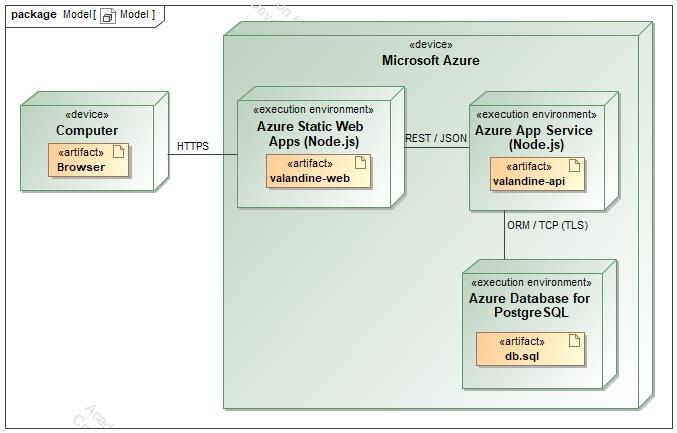
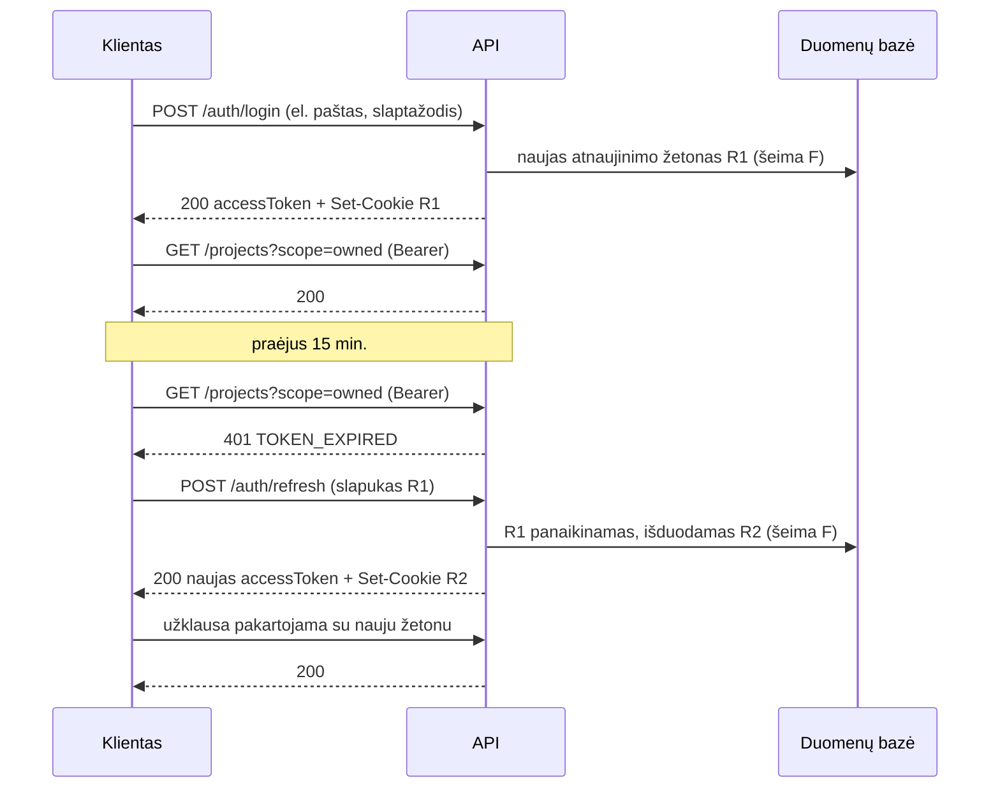
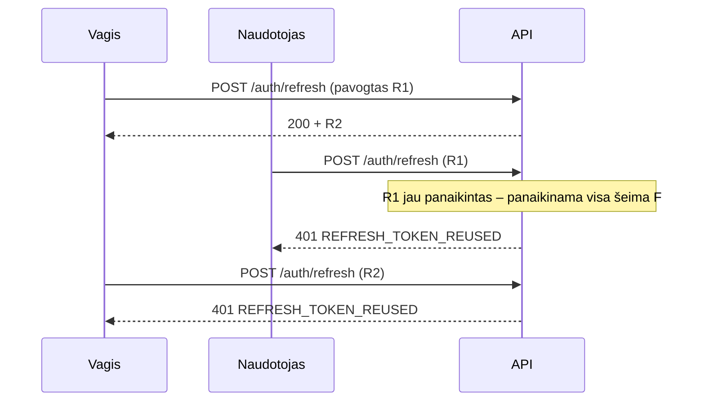

# Hourly

**T120B165 Saityno taikomųjų programų projektavimas** — projekto ataskaita

Kauno technologijos universitetas, Informatikos fakultetas

|  |  |
|---|---|
| Studentas | Tomas Barišauskas, IFF-3/2 |
| Dėstytojas | Tomas Blažauskas |
| Vieta ir metai | Kaunas, 2026 |

## Turinys

1. [Sprendžiamo uždavinio aprašymas](#1-sprendžiamo-uždavinio-aprašymas)
   - [1.1. Sistemos paskirtis](#11-sistemos-paskirtis)
   - [1.2. Funkciniai reikalavimai](#12-funkciniai-reikalavimai)
   - [1.3. Taikomosios srities objektai](#13-taikomosios-srities-objektai)
   - [1.4. Sąsajos metodai](#14-sąsajos-metodai)
2. [Sistemos architektūra](#2-sistemos-architektūra)
3. [Pasirinktų technologijų aprašymas](#3-pasirinktų-technologijų-aprašymas)
4. [Projekto paleidimas](#4-projekto-paleidimas)
5. [Autentifikacija ir autorizacija](#5-autentifikacija-ir-autorizacija)
6. [Klaidų apdorojimas](#6-klaidų-apdorojimas)
7. [Sąsajos demonstracija](#7-sąsajos-demonstracija)
8. [Reikalavimų atitiktis](#8-reikalavimų-atitiktis)

---

## 1. Sprendžiamo uždavinio aprašymas

### 1.1. Sistemos paskirtis

Projekto tikslas – sujungti darbų užsakovus ir laisvai samdomus specialistus vienoje aplinkoje bei užtikrinti skaidrią atliktų darbų laiko apskaitą.

Šiuo metu darbų paieška ir valandų fiksavimas dažniausiai vyksta atskirose priemonėse: susitariama socialiniuose tinkluose ar elektroniniu paštu, o valandos skaičiuojamos asmeninėse skaičiuoklėse. Dėl to užsakovas neturi galimybės matyti darbo eigos, o specialistui tenka rankiniu būdu rengti ataskaitas ir pagrįsti sugaištą laiką.

Veikimo principas – kuriamą platformą sudaro dvi dalys: internetinė aplikacija, kuria naudosis užsakovai, specialistai bei administratorius, ir aplikacijų programavimo sąsaja (angl. trump. API).

Užsakovas, norėdamas naudotis šia platforma, prisiregistruos prie internetinės aplikacijos ir galės paskelbti projektą: aprašyti darbo apimtį, nurodyti biudžeto rėžius bei pageidaujamą terminą. Priklausomai nuo pasirinkto režimo, užduotis projektui gali susivesti pats užsakovas arba jas pasiūlyti darbą laimėjęs specialistas.

Specialistai galės naršyti paskelbtus projektus ir teikti savo pasiūlymus, nurodydami kainą, valandinį įkainį bei numatomą atlikimo trukmę. Užsakovas, peržiūrėjęs gautus pasiūlymus, priims vieną iš jų – nuo to momento projektas įgyja vykdytoją.

Prasidėjus darbui, specialistas galės registruoti darbo sesijas prie konkrečių užduočių, o užsakovas realiu laiku matys darbo eigą ir sukauptą valandų skaičių. Pasibaigus darbui, sistema suformuos ataskaitą, kurioje pateikiama, kiek laiko skirta kiekvienai užduočiai ir kokia suma susidaro pagal sutartą įkainį.

Numatytas ir antrasis projektų kilmės būdas. Dalis darbų sutariama tiesiogiai – gyvai, telefonu ar per pažįstamus, o toks užsakovas paskyros platformoje neturi ir jos kurti nepageidauja. Tokiu atveju projektą susikuria pats specialistas, nurodydamas užsakovo pavadinimą laisvu tekstu. Pasiūlymų teikimo etapas praleidžiamas, o projektas iš karto pereina į vykdomo būseną.

Kad ir tiesiogiai sutarto darbo užsakovas galėtų matyti darbo eigą, specialistas jam sugeneruos peržiūros nuorodą. Ji suteikia prieigą prie konkretaus projekto neprisijungiant: atidaręs nuorodą užsakovas mato užduočių būsenas, sukauptas valandas ir susidariusią sumą. Nuoroda galioja ribotą laiką, yra tik skaitymo režimo ir bet kada gali būti atšaukta.

Administratorius prižiūrės platformos turinį: šalins taisyklių neatitinkančius projektus, blokuos pažeidėjų paskyras ir spręs kilusius nesutarimus.

Atsiskaitymai tarp šalių vykdomi už sistemos ribų – platforma atlieka darbų aikštelės ir laiko apskaitos funkciją, tačiau mokėjimų netarpininkauja.

### 1.2. Funkciniai reikalavimai

#### Neregistruotas sistemos naudotojas galės:

1. Peržiūrėti platformos reprezentacinį puslapį;
2. Peržiūrėti paskelbtų projektų sąrašą;
3. Peržiūrėti viešą projekto aprašymą;
4. Peržiūrėti projekto darbo eigą pagal gautą peržiūros nuorodą (matyti užduočių sąrašą ir jų būsenas, matyti sukauptų valandų suvestinę ir susidariusią sumą);
5. Užsiregistruoti prie platformos pasirenkant užsakovo arba specialisto rolę;
6. Prisijungti prie internetinės aplikacijos.

#### Registruotas sistemos naudotojas galės:

1. Atsijungti nuo internetinės aplikacijos;
2. Peržiūrėti ir redaguoti savo paskyros duomenis;
3. Peržiūrėti kito naudotojo viešą profilį;
4. Peržiūrėti savo projektų sąrašą.

#### Užsakovas galės:

1. Sukurti projektą:
   1. Nurodyti pavadinimą ir darbo aprašymą;
   2. Nurodyti biudžeto rėžius ir pageidaujamą terminą;
   3. Pasirinkti užduočių sudarymo režimą (užduotis sudaro užsakovas arba specialistas);
2. Sudaryti projekto užduočių sąrašą;
3. Paskelbti projektą viešai;
4. Peržiūrėti gautus pasiūlymus savo projektui;
5. Priimti vieną iš gautų pasiūlymų;
6. Atmesti pasiūlymą;
7. Patvirtinti specialisto pasiūlytas užduotis;
8. Peržiūrėti vykdomo projekto užduočių būsenas;
9. Peržiūrėti sukauptų valandų suvestinę pagal užduotis;
10. Suformuoti ir parsisiųsti projekto ataskaitą;
11. Redaguoti arba šalinti savo projektą;
12. Užbaigti projektą.

#### Specialistas galės:

1. Peržiūrėti paskelbtų projektų sąrašą ir jį filtruoti;
2. Pateikti pasiūlymą projektui:
   1. Nurodyti kainą ir valandinį įkainį;
   2. Nurodyti numatomą atlikimo trukmę;
   3. Pridėti laisvos formos žinutę užsakovui;
3. Peržiūrėti savo pateiktų pasiūlymų sąrašą ir jų būsenas;
4. Atšaukti savo pateiktą pasiūlymą;
5. Sudaryti laimėto projekto užduočių sąrašą, kai tokį režimą pasirinko užsakovas;
6. Sukurti tiesiogiai sutarto darbo projektą:
   1. Nurodyti pavadinimą, aprašymą ir valandinį įkainį;
   2. Nurodyti užsakovo pavadinimą, kai šis platformoje paskyros neturi;
   3. Sudaryti tokio projekto užduočių sąrašą;
7. Sugeneruoti projekto peržiūros nuorodą užsakovui;
8. Peržiūrėti sukurtų peržiūros nuorodų sąrašą ir jų galiojimo laiką;
9. Atšaukti peržiūros nuorodą;
10. Keisti užduoties būseną;
11. Registruoti darbo sesiją:
    1. Pradėti ir užbaigti laiko skaičiavimą;
    2. Įvesti sesiją rankiniu būdu;
    3. Pridėti komentarą apie atliktą darbą;
12. Redaguoti arba šalinti savo darbo sesiją;
13. Peržiūrėti savo darbo statistiką ir sukauptą uždarbį;
14. Suformuoti ir parsisiųsti projekto ataskaitą;
15. Užbaigti tiesiogiai sutartą projektą.

#### Administratorius galės:

1. Peržiūrėti visų naudotojų sąrašą;
2. Blokuoti ir atblokuoti naudotoją;
3. Šalinti naudotoją;
4. Peržiūrėti visus sistemoje esančius projektus;
5. Šalinti netinkamus projektus;
6. Peržiūrėti bet kurio projekto užduotis ir darbo sesijas sprendžiant ginčus.

### 1.3. Taikomosios srities objektai

Sistemos taikomosios srities objektai susieti hierarchiniu ir prasminiu ryšiu:

```
Projektas -> Užduotis -> Darbo sesija
```

**Projektas** yra darbas, kurį arba paskelbia užsakovas, arba tiesiogiai susikuria specialistas. Kiekvienas projektas skaidomas į **užduotis**, o kiekviena užduotis susideda iš **darbo sesijų**, kurias registruoja projektą vykdantis specialistas. Vidurinis lygmuo nėra vien struktūrinis: valandinis įkainis nurodomas projekto lygmenyje, tačiau atskira užduotis gali jį perrašyti, todėl sesijos vertė skaičiuojama pagal artimiausią nurodytą įkainį hierarchijoje.

Prie projekto taip pat siejami du hierarchijai nepriklausantys objektai. **Pasiūlymas** valdo aikštelės projekto gyvavimo ciklą, nes darbo sesijos gali atsirasti tik po to, kai vienas iš pasiūlymų priimamas. **Peržiūros nuoroda** suteikia paskyros neturinčiam užsakovui teisę skaityti konkretaus projekto darbo eigą.

### 1.4. Sąsajos metodai

Sąsaja suprojektuota pagal taikomosios srities objektų hierarchiją: kiekvienas
iš trijų pagrindinių objektų turi pilną penkių metodų rinkinį (sąrašas,
peržiūra, kūrimas, redagavimas, šalinimas).

Hierarchija atsispindi adresuose: užduotis pasiekiama tik per jos projektą, o
darbo sesija – per projektą ir užduotį:

```
/projects/{projectId}/tasks/{taskId}/sessions/{sessionId}
```

Kiekvienas identifikatorius ieškomas **savo tėvo viduje** (apimties valdymas per
URL, angl. scoping). Todėl kito projekto užduotis, paprašyta šio projekto adresu,
grąžina **404** – tokiu adresu resurso tiesiog nėra. Paieška vyksta iš išorės į
vidų, tad klaidos pranešimas įvardija pirmą netinkantį lygį („Task … does not
exist in project …“). Tai realizuota vienoje vietoje –
[lib/scope.ts](apps/api/src/lib/scope.ts). Tas pats principas taikomas
pasiūlymams ir peržiūros nuorodoms.

Lentelėse nurodyti klaidų kodai, būdingi konkrečiam metodui. Be jų, bet kuris
metodas su netinkamu ar pasibaigusiu prieigos žetonu grąžina **401**, o
užblokuoto naudotojo žetonu – **403**. Kas kokį metodą gali kviesti, aprašyta
[5.3 skyriuje](#53-rolės-ir-teisės).

**Projektas**

| Metodas | Paskirtis | Sėkmė | Klaidos |
|---|---|---|---|
| `GET /projects` | Projektų sąrašas | 200 | 400, 401, 403 |
| `GET /projects/{id}` | Projekto duomenys | 200 | 400, 404 |
| `POST /projects` | Sukurti projektą | 201 | 400, 401, 403, 422 |
| `PATCH /projects/{id}` | Redaguoti, paskelbti arba užbaigti | 200 | 400, 401, 403, 404, 422 |
| `DELETE /projects/{id}` | Šalinti projektą | 204 | 400, 401, 403, 404 |

**Užduotis**

| Metodas | Paskirtis | Sėkmė | Klaidos |
|---|---|---|---|
| `GET /projects/{projectId}/tasks` | Projekto užduotys | 200 | 400, 404 |
| `GET /projects/{projectId}/tasks/{taskId}` | Užduoties duomenys | 200 | 400, 404 |
| `POST /projects/{projectId}/tasks` | Sukurti užduotį | 201 | 400, 401, 403, 404, 422 |
| `PATCH /projects/{projectId}/tasks/{taskId}` | Redaguoti, perstumti, keisti būseną, patvirtinti | 200 | 400, 401, 403, 404, 422 |
| `DELETE /projects/{projectId}/tasks/{taskId}` | Šalinti užduotį | 204 | 400, 401, 403, 404, 422 |

**Darbo sesija**

| Metodas | Paskirtis | Sėkmė | Klaidos |
|---|---|---|---|
| `GET /projects/{projectId}/tasks/{taskId}/sessions` | Užduoties darbo sesijos (visi trys hierarchijos lygiai) | 200 | 400, 401, 403, 404 |
| `GET /projects/{projectId}/tasks/{taskId}/sessions/{sessionId}` | Sesijos duomenys | 200 | 400, 401, 403, 404 |
| `POST /projects/{projectId}/tasks/{taskId}/sessions` | Pradėti sesiją arba įvesti rankiniu būdu | 201 | 400, 401, 403, 404, 409, 422 |
| `PATCH /projects/{projectId}/tasks/{taskId}/sessions/{sessionId}` | Redaguoti arba užbaigti sesiją | 200 | 400, 401, 403, 404, 409, 422 |
| `DELETE /projects/{projectId}/tasks/{taskId}/sessions/{sessionId}` | Šalinti sesiją | 204 | 400, 401, 403, 404, 422 |

Nerastas tėvinis resursas grąžina 404, o ne tuščią sąrašą: „projekto nėra“ ir
„projektas yra, bet be užduočių“ yra du skirtingi atsakymai.

**Asmeniniai vaizdai.** Du sąrašai apima kelis projektus iš karto, todėl
negali būti vieno projekto viduje. Tai ne antri užduočių ar sesijų adresai, o
naudotojo atranka; kiekvienas elementas turi `projectId` (ir `taskId`), iš kurių
sudaromas jo vienintelis adresas.

| Metodas | Paskirtis | Sėkmė | Klaidos |
|---|---|---|---|
| `GET /tasks` | Naudotojo projektų užduotys | 200 | 400, 401 |
| `GET /sessions` | Naudotojo darbo žurnalas | 200 | 400, 401 |

Žinomu adresu naudojant nepalaikomą metodą (pvz., `PUT /projects/{id}`)
grąžinama **405** su `Allow` antrašte, išvardijančia palaikomus metodus. Sąrašas
sudaromas iš pačių maršrutų, todėl negali jiems prieštarauti.

Projektų sąrašo metodas priima `scope` parametrą, nurodantį, kurios projektų
aibės prašoma: `GET /projects?scope=marketplace` grąžina viešai paskelbtus,
`scope=owned` – naudotojo sukurtus, `scope=assigned` – jo vykdomus, o
`scope=all` – visus sistemos projektus (tik administratoriui). Toks
sprendimas pasirinktas vietoj atskirų adresų (pvz., `/my-projects`), nes
resursas išlieka tas pats, o keičiasi tik jo atrankos kriterijus.

**Puslapiavimas ir filtravimas.** Visi sąrašai grąžinami vienodu voku ir
priima `page` (nuo 1) bei `perPage` (1–100, numatytasis 20):

```json
{ "items": [ ... ], "page": 2, "perPage": 20, "total": 47, "totalPages": 3 }
```

`total` ir elementai skaičiuojami vienoje transakcijoje, todėl negali
prieštarauti vienas kitam. Puslapis už sąrašo pabaigos grąžina 200 su tuščiu
`items`, o ne 404 – kolekcija egzistuoja, tik tiek elementų neturi.

| Sąrašas | Filtrai |
|---|---|
| `GET /projects` | `scope`, `q` (pavadinimas, aprašymas), `status`, `origin` |
| `GET /projects/{projectId}/tasks` | `status`, `q` |
| `GET /tasks` | `projectId`, `status`, `q` |
| `GET …/tasks/{taskId}/sessions` | `from`, `to`, `running` |
| `GET /sessions` | `projectId`, `taskId`, `from`, `to`, `running` |
| `GET /proposals`, `GET /projects/{projectId}/proposals` | `status` |
| `GET /projects/{projectId}/shares` | `active` (neatšauktos ir nepasibaigusios) |
| `GET /users` | `q` (vardas, el. paštas), `role`, `isBlocked` |

`from` ir `to` priima datą (`2026-09-01`) arba laiko žymą ir atrenka pagal
pradžios laiką pusiau atviru intervalu `from <= startedAt < to`, todėl
gretimi laikotarpiai (vienos savaitės `to` – kitos `from`) sesijos neskaičiuoja
dukart. Loginiai filtrai priima tik žodžius `true` ir `false`. Netinkama
reikšmė arba `from`, einantis po `to`, grąžina 400.

**Hypermedia.** Kiekvienas resursas grąžinamas su `_links` objektu (HAL
stilius), kuriame yra dviejų rūšių nuorodos:

- **ryšiai** – kur rasti susijusius resursus: `self`, `project`, `task`,
  `tasks`, `sessions`, `report`, `client`, `specialist`;
- **veiksmai** – ką kviečiantysis gali daryti **dabar**, su HTTP metodu:
  `update`, `delete`, `publish`, `complete`, `cancel`, `create-task`,
  `submit-proposal`, `start-session`, `stop`, `approve`, `accept`, `reject`,
  `withdraw`, `revoke`.

```json
{
  "id": "…", "status": "IN_PROGRESS", "endedAt": null,
  "_links": {
    "self":    { "href": "/api/projects/P/tasks/T/sessions/S" },
    "task":    { "href": "/api/projects/P/tasks/T" },
    "project": { "href": "/api/projects/P" },
    "stop":    { "href": "/api/projects/P/tasks/T/sessions/S", "method": "PATCH" }
  }
}
```

Veiksmai priklauso nuo kviečiančiojo rolės ir resurso būsenos: juodraštis
užsakovui siūlo `publish`, paskelbtas projektas specialistui – `submit-proposal`,
vykdoma sesija jos autoriui – `stop`, o svečiui nesiūloma nieko. Veiksmo
nuoroda rodoma tada ir tik tada, kai maršrutas užklausą priimtų, nes sprendžiama
paleidžiant **tas pačias** `assert*` taisykles
([lib/links.ts](apps/api/src/lib/links.ts), funkcija `allows`), o ne jų kopiją.
Todėl klientas gali rodyti mygtukus pagal nuorodas ir nežinoti teisių lentelės.
Vienintelis dalykas, kurio nuoroda negali garantuoti, – konfliktas su kitais
resursais (409), pvz., antra vykdoma sesija.

Būsenos perėjimai (`publish`, `complete`, `cancel`, `accept`, `reject`,
`withdraw`, `stop`) yra `PATCH` tuo pačiu adresu – su `{"status": …}` arba,
sesijai, su `{"endedAt": …}`. Sąrašų vokas turi `self`, `first`, `last` ir, kai
yra, `prev` bei `next`; jos išlaiko visus užklausos filtrus. Adresai santykiniai
(`/api/…`), todėl veikia ir per web tarpinį maršrutą, ir įdiegus.

Įėjimo taškas `GET /api` grąžina nuorodas į viską, ką kviečiantysis gali
pasiekti: svečiui – aikštelę, registraciją ir prisijungimą, prisijungusiam –
savo projektus, užduotis, sesijas ar pasiūlymus, administratoriui – ir naudotojų
sąrašą. Klientui užtenka žinoti šį vieną adresą.

**Pasiūlymų valdymo metodai:**

| Metodas | Paskirtis | Sėkmė | Klaidos |
|---|---|---|---|
| `GET /proposals` | Savo pateiktų pasiūlymų sąrašas ir būsenos | 200 | 400, 401 |
| `GET /projects/{projectId}/proposals` | Projektui pateikti pasiūlymai | 200 | 400, 401, 404 |
| `GET /projects/{projectId}/proposals/{proposalId}` | Pasiūlymo duomenys | 200 | 400, 401, 404 |
| `POST /projects/{projectId}/proposals` | Pateikti pasiūlymą | 201 | 400, 401, 403, 404, 409, 422 |
| `PATCH /projects/{projectId}/proposals/{proposalId}` | Priimti, atmesti arba atšaukti | 200 | 400, 401, 403, 404, 409, 422 |
| `DELETE /projects/{projectId}/proposals/{proposalId}` | Šalinti savo pasiūlymą | 204 | 400, 401, 403, 404, 422 |

Pasiūlymo priėmimas vykdomas viena duomenų bazės transakcija: pasiūlymas įgyja
būseną `ACCEPTED`, kiti to projekto pasiūlymai atmetami, o projektas pereina į
`IN_PROGRESS` ir gauna vykdytoją. Būtent todėl `PATCH /projects/{id}` neleidžia
perėjimo `PUBLISHED → IN_PROGRESS` tiesiogiai – kitaip projektas galėtų atsidurti
vykdomoje būsenoje be priskirto specialisto.

**Peržiūros nuorodų ir ataskaitų metodai:**

| Metodas | Paskirtis | Sėkmė | Klaidos |
|---|---|---|---|
| `GET /projects/{projectId}/shares` | Projekto peržiūros nuorodų sąrašas | 200 | 400, 401, 403, 404 |
| `POST /projects/{projectId}/shares` | Sugeneruoti peržiūros nuorodą | 201 | 400, 401, 403, 404, 422 |
| `DELETE /projects/{projectId}/shares/{shareId}` | Atšaukti peržiūros nuorodą | 204 | 400, 401, 403, 404 |
| `GET /public/projects/{token}` | Projekto darbo eiga pagal nuorodą | 200 | 400, 404 |
| `GET /projects/{id}/report` | Projekto ataskaita (JSON arba CSV) | 200 | 400, 401, 403, 404, 406 |

Ataskaitos metodas taiko turinio derybas (angl. content negotiation): tas pats
resursas grąžinamas kaip `application/json` arba, nurodžius
`Accept: text/csv`, – kaip parsisiunčiamas CSV failas. Nepalaikomas tipas
grąžina 406, o ne tyliai JSON.

**Tarnybiniai metodai:** `GET /api` (įėjimo taškas su nuorodomis), `GET /health` ir
`GET /health/ready` (pastarasis tikrina ir jungtį su duomenų baze).

**Autentifikacijos metodai:**

| Metodas | Paskirtis | Sėkmė | Klaidos |
|---|---|---|---|
| `POST /auth/register` | Registracija, pasirenkant užsakovo arba specialisto rolę | 201 | 400, 409, 422 |
| `POST /auth/login` | Prisijungimas | 200 | 400, 401, 403, 422 |
| `POST /auth/refresh` | Naujas prieigos žetonas (atnaujinimo žetono rotacija) | 200 | 401, 403 |
| `POST /auth/logout` | Atsijungimas | 204 | – |
| `GET /auth/me` | Savo paskyros duomenys | 200 | 401 |
| `PATCH /auth/me` | Redaguoti savo vardą, aprašymą arba slaptažodį | 200 | 400, 401, 422 |

**Naudotojų valdymo metodai:**

| Metodas | Paskirtis | Sėkmė | Klaidos |
|---|---|---|---|
| `GET /users` | Visų naudotojų sąrašas (administratorius) | 200 | 400, 401, 403 |
| `GET /users/{id}` | Kito naudotojo viešas profilis | 200 | 400, 401, 404 |
| `PATCH /users/{id}` | Užblokuoti arba atblokuoti naudotoją (administratorius) | 200 | 400, 401, 403, 404, 422 |
| `DELETE /users/{id}` | Šalinti naudotoją be darbo istorijos (administratorius) | 204 | 400, 401, 403, 404, 409, 422 |

Iš viso sąsaja turi 38 metodus: 28 dalykinius (iš jų 15 pagrindinių CRUD),
6 autentifikacijos ir 4 naudotojų valdymo.

---

## 2. Sistemos architektūra

Sistemos sudedamosios dalys:

- **Kliento pusė** (angl. Front-End) – naudojant Next.js (React.js);
- **Serverio pusė** (angl. Back-End) – naudojant Node.js ir Express karkasą;
- **Duomenų bazė** – PostgreSQL.



*2.1 pav. Sistemos diegimo diagrama*

2.1 pav. pavaizduota kuriamos sistemos diegimo diagrama. Sistemos talpinimui yra naudojamos Microsoft Azure debesų technologijos.

Naudotojas su sistema sąveikauja per interneto naršyklę. Internetinė aplikacija yra talpinama Azure Static Web Apps paslaugoje ir pasiekiama saugiu HTTPS protokolu.

Šios sistemos veikimui (pvz., duomenų manipuliavimui su duomenų baze) yra reikalingas „Hourly“ API, kuris diegiamas atskiroje Azure App Service paslaugoje. Naršyklė į API tiesiogiai nesikreipia – užklausas persiunčia internetinė aplikacija, kuri veikia kaip tarpinis sluoksnis tarp naudotojo ir sąsajos. Toks sprendimas pasirinktas dėl saugumo: atnaujinimo žetonas saugomas `httpOnly` slapuke toje pačioje kilmėje (angl. origin), todėl jis nepasiekiamas kliento pusės scenarijams. Duomenų mainai tarp internetinės aplikacijos ir API vyksta JSON formatu, laikantis REST principų.

Pats „Hourly“ API vykdo duomenų mainus su duomenų baze – tam naudojama ORM sąsaja (Prisma). Duomenų bazė diegiama Azure Database for PostgreSQL Flexible Server paslaugoje, prieiga prie jos vykdoma šifruotu TLS kanalu ir apribota užkardos taisyklėmis, leidžiančiomis prisijungti tik iš API paslaugos.

---

## 3. Pasirinktų technologijų aprašymas

**Next.js (React)** – kliento pusės karkasas, pasirinktas dėl komponentinės architektūros ir serverio pusėje generuojamo turinio galimybės. Ji leidžia viešus projektų puslapius pateikti iš karto sugeneruotus, o naudotojo darbo aplinką – kaip vieno puslapio aplikaciją. Naudojama TanStack Query biblioteka užklausų būsenai ir podėliui valdyti bei Tailwind CSS apipavidalinimui.

**Node.js ir Express** – serverio pusės platforma ir karkasas. Pasirinkta dėl tos pačios programavimo kalbos abiejose sistemos dalyse, o tai leidžia dalytis tipų aprašais tarp kliento ir serverio. Express suteikia lankstų tarpinės programinės įrangos (angl. middleware) mechanizmą, patogų autentifikacijos ir autorizacijos tikrinimams įgyvendinti.

**Prisma ORM** – objektinio ir reliacinio atvaizdavimo sąsaja. Aprašo duomenų schemą viename faile, iš kurio generuojami tipizuoti duomenų prieigos metodai ir duomenų bazės migracijos.

**PostgreSQL** – reliacinė duomenų bazių valdymo sistema. Pasirinkta dėl dalinių unikalių indeksų (angl. partial unique index) palaikymo, kuris naudojamas užtikrinti, kad vienam projektui galėtų būti priimtas tik vienas pasiūlymas, o vienas naudotojas tuo pačiu metu galėtų turėti tik vieną neužbaigtą darbo sesiją.

**JWT (JSON Web Token)** – autentifikacijos ir autorizacijos priemonė. Naudojama trumpos galiojimo trukmės prieigos žetonų (15 min.) ir atnaujinimo žetonų pora. Prieigos žetone yra naudotojo identifikatorius, rolė ir prisijungimo identifikatorius (`sid`), todėl rolė žinoma be papildomos užklausos duomenų bazei, o atsijungus žetonas atmetamas iš karto. Atnaujinimo žetonas saugomas `httpOnly` slapuke, o duomenų bazėje laikoma tik jo maiša. Taikoma žetonų rotacijos strategija: kiekvienas atnaujinimas išduoda naują žetoną ir panaikina ankstesnįjį, o pakartotinai panaudojus jau anuliuotą žetoną panaikinama visa to prisijungimo žetonų šeima. Plačiau – 5 skyriuje.

**Gebėjimo žetonas** (angl. capability token) – antrasis prieigos mechanizmas, skirtas peržiūros nuorodoms. Skirtingai nei JWT, jis nesieja su naudotojo paskyra, o suteikia teisę skaityti vieną konkretų resursą. Žetonas generuojamas kriptografiškai saugiu atsitiktinių skaičių generatoriumi, duomenų bazėje saugoma tik jo maiša, galiojimo laikas ribotas, o teisės apribotos vien skaitymo metodais. Toks sprendimas leidžia dalytis darbo eiga su paskyros neturinčiu užsakovu, neįvedant papildomos registracijos. Kadangi žetonas perduodamas adreso eilutėje, atsakymuose nustatoma `X-Robots-Tag: noindex` antraštė, o nuoroda bet kada gali būti atšaukta nekeičiant paties projekto.

**OpenAPI 3.1** – sąsajos specifikacijos standartas. Specifikacija generuojama iš duomenų validavimo schemų (Zod) ir pateikiama per Swagger UI adresu `/api/docs`, taip užtikrinant, kad dokumentacija nenutoltų nuo realizacijos.

**Microsoft Azure** – debesų technologijų platforma, pasirinkta dėl universiteto suteikiamo studento kredito. Naudojamos Azure Static Web Apps, Azure App Service ir Azure Database for PostgreSQL Flexible Server paslaugos.

**Git ir GitHub Actions** – versijavimo sistema ir nepertraukiamo integravimo priemonė. Sujungus pakeitimus į pagrindinę šaką automatiškai paleidžiami testai, vykdomos duomenų bazės migracijos ir atnaujinamos Azure paslaugos.

---

## 4. Projekto paleidimas

### Reikalavimai

- Node.js 22 (žr. [.nvmrc](.nvmrc))
- Docker (PostgreSQL duomenų bazei) arba vietinė PostgreSQL 17

Duomenų bazės konteineris skelbiamas **5433** prievade, o ne įprastame 5432 –
taip išvengiama konflikto su kompiuteryje jau veikiančiu PostgreSQL. Prievadas
nurodytas [docker-compose.yml](docker-compose.yml) ir `apps/api/.env.example`
failuose.

### Saugyklos sandara

```
apps/api        Node.js + Express sąsaja (Prisma, Zod, OpenAPI)
apps/web        Next.js internetinė aplikacija (TanStack Query, Tailwind)
packages/shared Bendri Zod aprašai ir tipai, naudojami abiejose pusėse
```

### Paruošimas

```bash
npm install
cp apps/api/.env.example apps/api/.env
cp apps/web/.env.example apps/web/.env.local
npm run db:up
npm run db:migrate
npm run db:seed
```

### Kasdienis darbas

```bash
npm run dev
```

| Adresas | Paskirtis |
|---|---|
| http://localhost:3000 | Internetinė aplikacija |
| http://localhost:4000/api/health | Sąsajos būsenos patikrinimas |
| http://localhost:4000/api/docs | Sąsajos dokumentacija (Swagger UI) |

Naršyklė į API tiesiogiai nesikreipia – užklausos eina per Next.js maršrutą
[`/api/[...path]`](apps/web/src/app/api/%5B...path%5D/route.ts), kuris veikia kaip
tarpinis sluoksnis ir leidžia atnaujinimo žetoną laikyti `httpOnly` slapuke.

### Naudingos komandos

| Komanda | Paskirtis |
|---|---|
| `npm run dev:api` / `npm run dev:web` | Paleisti tik vieną dalį |
| `npm run db:up` / `npm run db:down` | Pakelti / sustabdyti duomenų bazės konteinerį |
| `npm run db:migrate` | Sukurti ir pritaikyti migraciją |
| `npm run db:studio` | Prisma Studio duomenų peržiūrai |
| `npm run lint` | Statinė analizė |
| `npm run test` | Testai |
| `npm run demo` | Sąsajos demonstracija (žr. 7 skyrių) |
| `npm run openapi:export` | Atnaujinti `docs/openapi.json` |
| `npm run build` | Sukompiliuoti visas dalis |

### Demonstracinės paskyros

Po `npm run db:seed` sukuriamos devynios paskyros, visos su slaptažodžiu
`slaptazodis123`:

| Paskyra | Rolė | Pastaba |
|---|---|---|
| `admin@hourly.lt` | Administratorius | |
| `uzsakovas@hourly.lt` | Užsakovas | Turi vykdomą ir užbaigtą projektą |
| `rasa@zalialanka.lt` | Užsakovas | Turi paskelbtą projektą su pasiūlymais |
| `mindaugas@kavinepupa.lt` | Užsakovas | Turi juodraštinį projektą |
| `specialistas@hourly.lt` | Specialistas | Pagrindinė demonstracijos paskyra |
| `gabija@dizainas.lt` | Specialistas | Užbaigė projektą su ataskaita |
| `tomas@frontend.lt` | Specialistas | Turi atmestą ir atsiimtą pasiūlymą |
| `ieva@duomenys.lt` | Specialistas | **Turi vykdomą darbo sesiją** |
| `blokuotas@hourly.lt` | Specialistas | **Užblokuota** – prisijungus grąžinama 403 `ACCOUNT_BLOCKED` |

Duomenyse yra visos projekto ir pasiūlymo būsenos, 21 užduotis, 26 darbo sesijos
(iš jų viena vykdoma) ir šešios peržiūros nuorodos: galiojančios, pasibaigusi ir
atšauktos. Parduotuvės projektas turi penkias užduotis, o jo užduotis „Užsakymų
sąrašas su filtrais“ – penkias sesijas, todėl visi trys hierarchijos lygiai ir
puslapiavimas rodomi su prasmingu kiekiu duomenų. Seed yra pakartojamas – paleidus iš naujo duomenys atstatomi, o
identifikatoriai nesikeičia.

Sukurti identifikatoriai ir peržiūros nuorodų žetonai įrašomi į
`docs/postman/demo-data.json` (failas negrįžta į Git, nes generuojamas iš naujo).

---

## 5. Autentifikacija ir autorizacija

Sąsaja naudoja žetonais grįstą autentifikaciją. Prisijungęs naudotojas gauna
trumpai galiojantį **prieigos žetoną** (JWT), kurį siunčia su kiekviena
užklausa, ir ilgai galiojantį **atnaujinimo žetoną**, kuriuo gauna naują
prieigos žetoną, kai ankstesnysis baigia galioti.

### 5.1. Žetonai

|  | Prieigos žetonas | Atnaujinimo žetonas |
|---|---|---|
| Forma | JWT, pasirašytas `HS256` | Atsitiktinė 256 bitų eilutė (ne JWT) |
| Perdavimas | `Authorization: Bearer <žetonas>` | `httpOnly` slapukas `hourly_refresh`, siunčiamas tik `/api/auth` keliu |
| Kliento pusėje | Programos atmintyje | Naršyklės slapukuose, scenarijams nepasiekiamas |
| Serverio pusėje | Nesaugomas – tikrinamas parašas | Duomenų bazėje, tik `sha256` maiša |
| Galiojimas | 15 min. | 30 d. |
| Turinys | `sub` (naudotojo id), `role`, `sid` (prisijungimas), `iat`, `exp`, `iss`, `aud` | – |
| Atšaukimas | Kartu su savo prisijungimu (`sid`) | Atsijungiant, keičiant slaptažodį, blokuojant naudotoją |

Prieigos žetono turinio pavyzdys:

```json
{
  "sub": "a0000000-0000-4000-8000-000000000003",
  "role": "SPECIALIST",
  "sid": "6e894cf1-2c63-43be-a780-18201ac6dc25",
  "iat": 1790276285,
  "exp": 1790277185,
  "iss": "hourly-api",
  "aud": "hourly"
}
```

El. pašto ir kitų asmens duomenų žetone nėra: JWT yra tik užkoduotas, o ne
užšifruotas, todėl jo turinį gali perskaityti kiekvienas.

Atnaujinimo žetonas nėra JWT, nes jo turinio niekam nereikia skaityti – serveris
jį randa duomenų bazėje pagal maišą. Būtent dėl to jį galima atšaukti. Nutekėjus
duomenų bazei, žetonų atkurti iš maišų neįmanoma.

Prieigos žetono tikrinimas ([middleware/auth.ts](apps/api/src/middleware/auth.ts)):

- **Algoritmas prisegtas.** Priimamas tik `HS256`, todėl žetonai su `alg: none`
  ar kitu algoritmu atmetami. Taip pat tikrinami `iss`, `aud` ir turinio forma.
- **Rolė imama iš žetono**, tačiau kiekviena užklausa viena paieška patikrina,
  ar paskyra dar egzistuoja, nėra užblokuota ir ar žetono prisijungimas (`sid`)
  dar galioja. Todėl užblokuotas arba atsijungęs naudotojas praranda prieigą iš
  karto, o ne po 15 min.
- **Pasibaigęs žetonas turi atskirą kodą** `TOKEN_EXPIRED`: klientas žino, kad
  reikia kviesti `/auth/refresh`, o ne rodyti prisijungimo formą.
- **Netinkamas žetonas nereiškia svečio teisių.** Jei žetonas pateiktas, bet
  netinka, grąžinama 401 net viešame metode – naudotojas tyliai netampa svečiu.
- Kiekvienas 401 atsakymas turi `WWW-Authenticate: Bearer` antraštę (RFC 6750).

### 5.2. Žetonų atnaujinimas ir rotacija



*5.1 pav. Prieigos žetono atnaujinimas*

Kiekvienas atnaujinimo žetonas veikia **vieną kartą**. Jei jau panaudotas
žetonas pateikiamas dar kartą, vadinasi, jį turi dvi šalys – savininkas ir tas,
kuris jį nukopijavo. Serveris negali nustatyti, kuri iš jų sąžininga, todėl
panaikina visą šeimą, t. y. visus to prisijungimo žetonus:



*5.2 pav. Pakartotinio panaudojimo aptikimas*

Teisėtas naudotojas prisijungia iš naujo, o vagis prieigą praranda.

| Įvykis | Kas panaikinama |
|---|---|
| Atsijungimas (`POST /auth/logout`) | To prisijungimo šeima; slapukas išvalomas |
| Slaptažodžio keitimas (`PATCH /auth/me`) | Visos kitos naudotojo šeimos – dabartinis prisijungimas (`sid`) lieka |
| Blokavimas (`PATCH /users/{id}`) | Visos naudotojo šeimos; prieigos žetonai atmetami nuo kitos užklausos |
| Pakartotinis žetono panaudojimas | Ta šeima |

**Prieigos žetonas miršta kartu su savo prisijungimu.** Šeima – tai vienas
prisijungimas, o prieigos žetonas ją įvardija `sid` teiginiu. Kiekviena
užklausa (toje pačioje paieškoje, kuri tikrina blokavimą) patikrina, ar šeimoje
dar yra galiojantis atnaujinimo žetonas. Panaikinus šeimą – atsijungus,
pakeitus slaptažodį kitame įrenginyje ar aptikus pakartotinį panaudojimą – tas
pats prieigos žetonas nuo kitos užklausos gauna **401 `SESSION_REVOKED`**, o ne
veikia iki savo `exp`. Rotacija seną atnaujinimo žetoną panaikina ir naują
įrašo vienoje transakcijoje, todėl šeima niekada nelieka be galiojančio žetono
ir lygiagrečios užklausos atnaujinimo metu neatmetamos.

JWT lieka pasirašytas ir savarankiškas (rolę ir naudotoją serveris sužino be
duomenų bazės), tačiau „stateless“ čia sąmoningai ne visiškas: kaina – viena
paieška pagal indeksą kiekvienai užklausai, nauda – tikras atsijungimas.

Metodai `/auth/register`, `/auth/login`, `/auth/refresh` ir `/auth/logout`
`Authorization` antraštės nežiūri. Klientai dažnai prideda žetoną prie visų
užklausų, todėl kitaip pasibaigęs prieigos žetonas užblokuotų būtent tą
užklausą, kuri turi jį pakeisti.

### 5.3. Rolės ir teisės

Sistemoje yra keturios rolės: **svečias** (be žetono), **užsakovas** (`CLIENT`),
**specialistas** (`SPECIALIST`) ir **administratorius** (`ADMIN`).
Registruojantis galima pasirinkti tik užsakovo arba specialisto rolę.

Teisės tikrinamos dviem žingsniais, o jų atsakymai skiriasi:

1. **Ar naudotojas gali matyti resursą?** Jei ne – **404**, lygiai toks pat, kaip
   neegzistuojančiam resursui. Taip svetimo juodraščio identifikatorius
   neatskleidžia, kad projektas egzistuoja.
2. **Ar gali atlikti šį veiksmą?** Jei mato, bet negali – **403**.

Paskelbtą projektą mato visi, kitus – tik jo šalys ir administratorius.
Administratorius mato viską (moderavimui ir ginčams spręsti), gali šalinti
projektus ir naudotojus, tačiau svetimų projektų, užduočių ir sesijų nekeičia.

Visos taisyklės surašytos viename faile –
[services/access.ts](apps/api/src/services/access.ts), – o kiekviena lentelės
eilutė turi testą ([access.test.ts](apps/api/src/services/access.test.ts)).

Žymėjimai: **S** – svečias, **U** – užsakovas, **Sp** – specialistas,
**A** – administratorius; „šalis“ – projekto užsakovas arba jį vykdantis
specialistas.

| Metodai | S | U | Sp | A |
|---|---|---|---|---|
| `POST /auth/register`, `/login`, `/refresh`, `/logout` | ✓ | ✓ | ✓ | ✓ |
| `GET`, `PATCH /auth/me`; `GET /users/{id}` | 401 | ✓ | ✓ | ✓ |
| `GET /users`; `PATCH`, `DELETE /users/{id}` | 401 | 403 | 403 | ✓, išskyrus save |
| `GET /projects?scope=marketplace` | ✓ | ✓ | ✓ | ✓ |
| `GET /projects?scope=owned` arba `assigned` | 401 | ✓ | ✓ | ✓ |
| `GET /projects?scope=all` | 401 | 403 | 403 | ✓ |
| `GET /projects/{id}`, `/projects/{id}/tasks`, `/projects/{id}/tasks/{taskId}` | paskelbtas | šalis arba paskelbtas | šalis arba paskelbtas | ✓ |
| `POST /projects` – aikštelės projektas | 401 | ✓ | 403 | 403 |
| `POST /projects` – tiesioginis projektas | 401 | 403 | ✓ | 403 |
| `PATCH /projects/{id}`; užduočių kūrimas, keitimas, šalinimas; peržiūros nuorodos | 401 | šalis | šalis | 403 |
| `DELETE /projects/{id}` | 401 | savo aikštelės projektas | savo tiesioginis projektas | ✓ |
| `GET /projects/{id}/report`, `…/tasks/{taskId}/sessions`, `…/sessions/{sessionId}` | 401 | šalis | šalis | ✓ |
| `GET /tasks`, `/sessions`, `/proposals` | 401 | savo | savo | savo |
| `POST …/tasks/{taskId}/sessions`; `PATCH`, `DELETE …/sessions/{sessionId}` | 401 | 403 | vykdytojas, sesijos autorius | 403 |
| `GET /projects/{id}/proposals`, `…/proposals/{proposalId}` | 401 | visi savo projekto | tik savo | visi |
| `POST /projects/{id}/proposals` | 401 | 403 | ✓ | 403 |
| `PATCH /projects/{id}/proposals/{proposalId}` | 401 | priimti, atmesti | atšaukti savo | 403 |
| `DELETE /projects/{id}/proposals/{proposalId}` | 401 | 403 | savo | 403 |
| `GET /public/projects/{token}`, `GET /health` | ✓ | ✓ | ✓ | ✓ |

Kai naudotojas nėra projekto šalis, atsakymas yra 404, jei projektas jam
nematomas, ir 403, jei matomas (paskelbtas).

Administratorius negali užblokuoti ar ištrinti savo paskyros (422). Naudotojo,
kuris dalyvauja projektuose arba turi darbo sesijų, ištrinti negalima (409) –
kaskadinis šalinimas ištrintų ir kitos šalies įrašus, todėl tokį naudotoją
reikia blokuoti.

### 5.4. Saugumo priemonės

| Grėsmė | Priemonė |
|---|---|
| Slaptažodžių nutekėjimas iš duomenų bazės | `bcrypt`, kaina 12 |
| Atnaujinimo žetonų nutekėjimas iš duomenų bazės | Saugoma tik `sha256` maiša |
| XSS pavagia atnaujinimo žetoną | `httpOnly` slapukas |
| CSRF per slapuką | `SameSite=Lax`, `Path=/api/auth`, CORS tik iš `WEB_ORIGIN` |
| Pavogtas atnaujinimo žetonas | Rotacija ir visos šeimos panaikinimas pakartotinai jį panaudojus |
| Pavogtas prieigos žetonas | Galioja tik 15 min.; atsijungus nustoja galioti iš karto (`sid`) |
| Slaptažodžio spėliojimas (brute force) | Po 10 nesėkmingų bandymų tam pačiam el. paštui iš to paties adreso per 15 min. – **429** su `Retry-After`; registracija – 30 per valandą, `/auth/refresh` – 30 nesėkmių per 15 min. ([lib/rate-limit.ts](apps/api/src/lib/rate-limit.ts)) |
| Suklastotas žetonas, `alg: none` | Parašo patikra, leidžiamas tik `HS256` |
| Teisių didinimas registruojantis | Registracijoje leidžiamos tik `CLIENT` ir `SPECIALIST` rolės |
| Naudotojų išvardijimas | Vienodas 401 nežinomam el. paštui ir blogam slaptažodžiui, vienodas atsakymo laikas; svetimi resursai – 404 |
| Užblokuotas naudotojas su galiojančiu žetonu | Paskyros būsena tikrinama kiekvienoje užklausoje |
| Prieiga prie svetimų resursų (IDOR) | Matomumo ir teisių patikros kiekviename metode, padengtos testais |
| Silpna paslaptis gamybinėje aplinkoje | Paleidžiant tikrinama, ar `JWT_ACCESS_SECRET` turi bent 32 simbolius |

---

## 6. Klaidų apdorojimas

Visos klaidos grąžinamos vienodu formatu, nepriklausomai nuo to, kuriame
sluoksnyje jos kilo – schemos validavime, dalykinėje taisyklėje ar duomenų
bazės apribojime:

```json
{
  "error": {
    "code": "INVALID_STATUS_TRANSITION",
    "message": "Cannot change project status from PUBLISHED to IN_PROGRESS.",
    "details": { "from": "PUBLISHED", "to": "IN_PROGRESS" }
  }
}
```

`code` skirtas programai, `message` – žmogui, o neprivalomas `details` nurodo
konkretų lauką ar apribojimą. Validavimo klaidų atveju `details` yra laukų
medis, todėl kliento pusė gali pažymėti būtent tą įvedimo lauką, kuris
neatitiko reikalavimų.

### 6.1. Statuso kodų politika

| Kodas | Kada grąžinamas | Pavyzdys |
|---|---|---|
| 400 | Užklausos **sintaksė** netinkama – serveris jos net negali suprasti | netaisyklingas JSON, `id` ne UUID, `scope=nesamas` |
| 401 | Naudotojas neatpažintas: žetono nėra, jis netinkamas arba pasibaigęs | užduoties kūrimas be žetono |
| 403 | Naudotojas atpažintas, bet jo rolė ar ryšys su resursu neleidžia veiksmo | specialistas kuria aikštelės projektą, redaguojamas svetimas paskelbtas projektas |
| 404 | Resurso nėra arba naudotojas jo negali matyti | nesamas projektas, svetimas juodraštis, kito projekto užduotis šio projekto adresu |
| 405 | Adresas žinomas, bet metodas nepalaikomas (`Allow` antraštė) | `PUT /projects/{id}` |
| 406 | Prašomas turinio tipas neprieinamas | `Accept: application/xml` ataskaitai |
| 409 | Konfliktas su esama duomenų būsena | antra neužbaigta darbo sesija |
| 422 | Užklausa suprantama, bet jos **turinys** prieštarauja taisyklėms | per trumpas pavadinimas, neleistinas būsenos perėjimas |

Skirtumas tarp 400 ir 422 yra esminis ir nuoseklus visoje sąsajoje: 400 reiškia
netvarkingą užklausą, 422 – tvarkingą užklausą su netinkamu turiniu. Tėviniai
resursai nurodomi adresu, ne kūne, todėl jų nebuvimas visada yra 404:

- `GET /projects/{ne-uuid}` → **400**, nes toks adresas negali egzistuoti;
- `GET /projects/{nesamas-id}` arba `POST /projects/{nesamas-id}/tasks` → **404**, nes adresas nurodo neegzistuojantį resursą;
- `GET /projects/{A}/tasks/{B projekto užduotis}` → **404**, nes šiuo adresu užduoties nėra;
- `POST /projects/{id}/tasks` su per trumpu pavadinimu → **422**, nes adresas teisingas, o klaida yra turinyje.

### 6.2. Mašininiai klaidų kodai

| Kodas | Reikšmė |
|---|---|
| `MALFORMED_JSON` | Užklausos kūnas nėra taisyklingas JSON |
| `INVALID_PATH_PARAM`, `INVALID_QUERY` | Netinkamas adreso arba užklausos parametras |
| `VALIDATION_ERROR` | Turinys neatitinka duomenų schemos |
| `AUTH_REQUIRED` | Metodui reikia prisijungti, o žetono nėra |
| `INVALID_TOKEN`, `TOKEN_EXPIRED` | Prieigos žetonas netinkamas arba pasibaigęs |
| `SESSION_REVOKED` | Žetono prisijungimas baigtas (atsijungta, pakeistas slaptažodis, aptiktas pakartotinis panaudojimas) |
| `TOO_MANY_REQUESTS` | Viršytas bandymų limitas; `Retry-After` nurodo, po kiek sekundžių bandyti vėl |
| `INVALID_CREDENTIALS` | Neteisingas el. paštas arba slaptažodis |
| `INVALID_REFRESH_TOKEN`, `REFRESH_TOKEN_REUSED` | Atnaujinimo žetono nėra, jis nežinomas, pasibaigęs arba jau panaudotas |
| `FORBIDDEN` | Rolė arba ryšys su resursu neleidžia veiksmo |
| `ACCOUNT_BLOCKED` | Naudotojas užblokuotas |
| `EMAIL_TAKEN` | Paskyra su tokiu el. paštu jau yra |
| `INVALID_PASSWORD` | Keičiant slaptažodį neteisingai nurodytas dabartinis |
| `CANNOT_MODIFY_SELF`, `USER_HAS_WORK_HISTORY` | Administratorius bando blokuoti save arba šalinti naudotoją su darbo istorija |
| `NOT_FOUND` | Resursas nerastas (taip pat – vaikas ne savo tėvo adresu) |
| `METHOD_NOT_ALLOWED` | Adresas žinomas, metodas – ne |
| `MALFORMED_URL`, `BAD_REQUEST` | Adreso nepavyksta iškoduoti arba kita užklausos klaida, aptikta Express |
| `VALUE_OUT_OF_RANGE` | Skaičius netelpa į duomenų bazės stulpelį |
| `INVALID_REFERENCE` | Nurodytas neegzistuojantis susijęs įrašas |
| `INVALID_STATUS_TRANSITION` | Neleistinas projekto būsenos perėjimas |
| `INVALID_BUDGET_RANGE`, `INVALID_TIME_RANGE`, `TIMESTAMP_IN_FUTURE` | Nenuoseklios reikšmės |
| `PROJECT_CLOSED`, `PROJECT_NOT_IN_PROGRESS`, `PROJECT_NOT_PUBLISHED` | Veiksmas neatitinka projekto būsenos |
| `NO_PROPOSAL_STAGE`, `PROPOSAL_NOT_PENDING`, `PROPOSAL_ACCEPTED` | Pasiūlymų gyvavimo ciklo taisyklės |
| `SESSION_ALREADY_RUNNING`, `PROPOSAL_ALREADY_SUBMITTED`, `CONFLICT` | Konfliktai su esama būsena |
| `NOT_ACCEPTABLE` | Neprieinamas prašomas turinio tipas |
| `INTERNAL_ERROR` | Vidinė serverio klaida (gamyboje priežastis neatskleidžiama) |

Dalis konfliktų tikrinama dviem lygmenimis: programa pateikia aiškų pranešimą,
o galutinę garantiją duoda duomenų bazės daliniai unikalūs indeksai
(`work_sessions_one_open_per_specialist`, `proposals_one_accepted_per_project`).
Tik pastarieji apsaugo tuo atveju, kai dvi užklausos ateina vienu metu.

---

## 7. Sąsajos demonstracija

Sąsajos veikimą galima patikrinti trimis būdais.

**1. Swagger UI** – adresu `http://localhost:4000/api/docs`. Specifikacija
generuojama iš tų pačių Zod schemų, kuriomis validuojamos užklausos, todėl
dokumentacija negali nutolti nuo realizacijos. Ta pati specifikacija saugoma ir
saugykloje: [docs/openapi.json](docs/openapi.json); nepertraukiamo integravimo
darbo eiga tikrina, ar įrašytas failas atitinka kodą.

**2. Automatinė demonstracija** – Postman kolekcija, paleidžiama per Newman.
Kolekcija prisijungia demonstracinėmis paskyromis, todėl prieš pirmą paleidimą
reikia `npm run db:seed`:

```bash
npm run dev:api   # viename terminale
npm run demo      # kitame
```

Kolekciją taip pat galima importuoti į Postman
([kolekcija](docs/postman/hourly.postman_collection.json),
[aplinka](docs/postman/hourly.local.postman_environment.json)) ir paleisti
mygtuku „Run collection“.

Kolekciją sudaro septynios dalys:

| Dalis | Turinys |
|---|---|
| 0. Autentifikacija | Registracija, žetono rotacija, pakartotinio panaudojimo aptikimas, atsijungimas (prieigos žetonas atmetamas iš karto – `SESSION_REVOKED`), savo paskyros redagavimas (rolė iš kūno ignoruojama), 409 / 422 / 401 / 403 atvejai, JWT turinio patikra ir prisijungimas keturiomis paskyromis |
| 1. Darbo eiga | Pilnas gyvavimo ciklas: visi 15 pagrindinių metodų, hierarchiniai metodai, du konkuruojantys pasiūlymai (priėmus vieną, kitas atmetamas), ataskaita (JSON ir CSV), peržiūros nuoroda; puslapiavimas ir filtrai; hypermedia – užklausos, sekančios `_links` |
| 2. Klaidų apdorojimas | Kodai 400, 401, 404, 405, 406 ir 422 su skirtingomis priežastimis, tarp jų – suklastotas žetonas, vaikas ne savo tėvo adresu ir ribiniai atvejai, kurie anksčiau grąžindavo 500 (NUL simbolis, neiškoduojamas adresas, per didelė suma) |
| 3. Rolės ir teisės | 5.3 skyriaus lentelė: kas mato, kas gali kurti, redaguoti ir šalinti; 403 ir 404 skirtumas |
| 4. Administratorius | Naudotojų sąrašas, viešas profilis, blokavimas (žetonas atmetamas iš karto), atblokavimas, šalinimas, netinkamo projekto pašalinimas |
| 5. Valymas | Sukurtų duomenų šalinimas ir 204 bei 404 atsakymų patikra |
| 6. Bandymų ribojimas | Dešimt nesėkmingų prisijungimų (401), vienuoliktas – 429 su `Retry-After`. El. paštas kiekvienam paleidimui naujas, todėl ankstesni paleidimai neišnaudoja limito |

Scenarijus sukuria viską, ko jam reikia, ir pabaigoje ištrina – taip pat ir
demonstracijos metu užregistruotą paskyrą, – todėl demonstraciją galima kartoti
nepaleidžiant pradinių duomenų iš naujo. Rezultatas:

```
requests 138 | assertions 295 | failed 0 | total run duration: ~18s
```

Kolekcija kviečia **visus** dokumentuotus metodus. Tai tikrina CI:
`npm run postman:coverage` palygina `docs/openapi.json` operacijas su kolekcijos
užklausomis ir nepavyksta, jei kuriam nors metodui užklausos nėra.

Kadangi laikai užklausose fiksuoti, testai tikrina ne „kažkokį skaičių“, o
konkrečias reikšmes: serverio apskaičiuotą 90 minučių trukmę, iš projekto
paveldėtą 40 EUR/val. įkainį bei 210 minučių ir 140 EUR suvestinę – tą pačią
tiek ataskaitoje, tiek viešoje peržiūroje.

**3. Vienetiniai testai** – `npm run test` paleidžia 286 testus, tikrinančius
dalykines taisykles (būsenų perėjimus, įkainio paveldėjimą, trukmės
skaičiavimą, klaidų kodų politiką), žetonų pasirašymą ir tikrinimą (tarp jų –
suklastotus ir pasibaigusius žetonus), atnaujinimo žetonų rotaciją, visą rolių
ir teisių lentelę ir tai, kad atsakymų struktūra atitinka OpenAPI specifikaciją.

---

## 8. Reikalavimų atitiktis

### 8.1. 1 laboratorinis darbas – sąsaja

| Reikalavimas | Kaip tenkinamas |
|---|---|
| Realizuoti visi numatyti API metodai | 28 dalykiniai metodai, iš jų 15 pagrindinių CRUD (1.4 skyrius) |
| OpenAPI specifikacija kiekvienam metodui | Generuojama iš Zod schemų, pateikiama `/api/docs` ir [docs/openapi.json](docs/openapi.json) |
| Patogi paleidimo aplinka | `npm install` → `npm run db:up` → `db:migrate` → `db:seed` → `npm run dev` |
| Duomenų bazės sprendimas | PostgreSQL 17 su Prisma ORM, migracijos saugykloje |
| Prasmingi duomenys gynimo metu | 9 naudotojai, 7 projektai (visos būsenos), 21 užduotis, 26 darbo sesijos, 7 pasiūlymai, 6 peržiūros nuorodos |
| Teisingas turinio tipas | `application/json` ir `text/csv` (ataskaitos parsisiuntimas) |
| 404, kai resursas nerandamas | 6 skyrius; demonstracijos 2, 3 ir 5 dalys |
| 400 / 422 netinkamam turiniui | 6.1 skyrius; demonstracijoje – trys 400 ir trys 422 atvejai |
| 201 sukūrus resursą | Visi kūrimo metodai, kartu grąžinama `Location` antraštė |
| 200 / 204 ištrynus resursą | Visi šalinimo metodai grąžina 204 be turinio |
| Kodas Git saugykloje, dokumentacija | GitHub; ataskaita – šis `README.md`, darbų planai – [docs/planas.md](docs/planas.md), [docs/planas-2.md](docs/planas-2.md) |

### 8.2. 2 laboratorinis darbas – autentifikacija ir autorizacija

| Reikalavimas | Kaip tenkinamas |
|---|---|
| Žetonais grįsta autentifikacija | JWT prieigos žetonas `Authorization: Bearer` antraštėje (5.1 skyrius) |
| Bent trys rolės | Svečias, užsakovas, specialistas, administratorius (5.3 skyrius) |
| Rolė JWT žetone | `role` žetono turinyje; demonstracija tikrina dekoduotą žetoną |
| Atnaujinimo žetonų strategija | `httpOnly` slapukas, rotacija, šeimos panaikinimas pakartotinai panaudojus (5.2 skyrius) |
| Atsijungimas | `POST /auth/logout` panaikina prisijungimo žetonų šeimą; to prisijungimo prieigos žetonai atmetami iš karto (`SESSION_REVOKED`) |
| Metodų apsauga pagal roles | `requireRole`, `services/access.ts`; demonstracijos 3 ir 4 dalys |
| Naudotojas keičia tik savo resursus | Šalies, autoriaus ir kūrėjo patikros (5.3 skyrius) |
| 401 neautentifikuotam naudotojui | Be žetono, su suklastotu ar pasibaigusiu žetonu; `WWW-Authenticate` antraštė |
| 403 neturinčiam teisių | Netinkama rolė, svetimas matomas resursas, užblokuota paskyra |
| Administratoriaus funkcijos | `/users` metodai, `scope=all`, bet kurio projekto šalinimas |
| Saugus slaptažodžių ir žetonų saugojimas | `bcrypt`; atnaujinimo žetonų tik `sha256` maišos (5.4 skyrius) |
| Saugumas aprašytas specifikacijoje | OpenAPI `bearerAuth` ir `refreshCookie` schemos, **Authorize** mygtukas Swagger UI |
| Demonstracija iki ~15 s | `npm run demo` – 91 užklausa per ~11 s |
