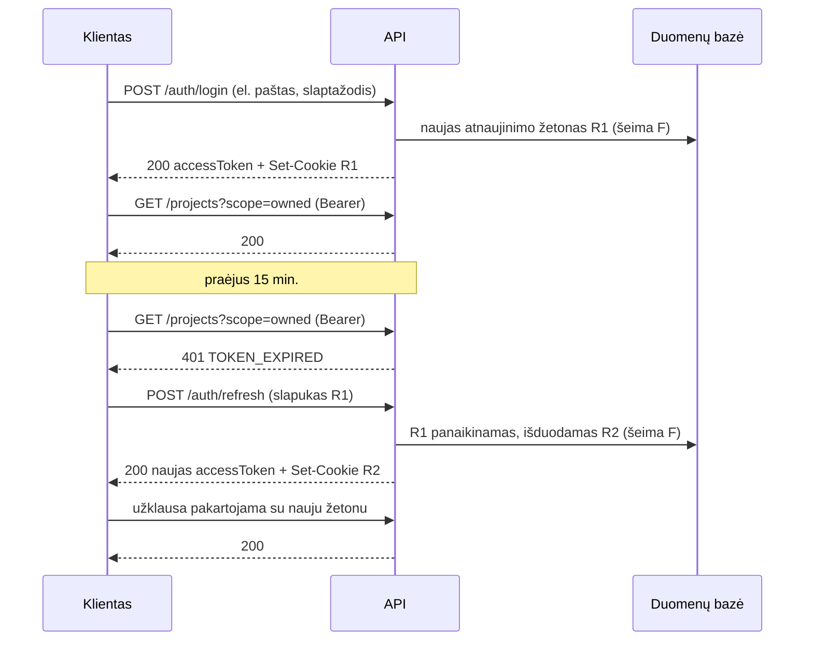
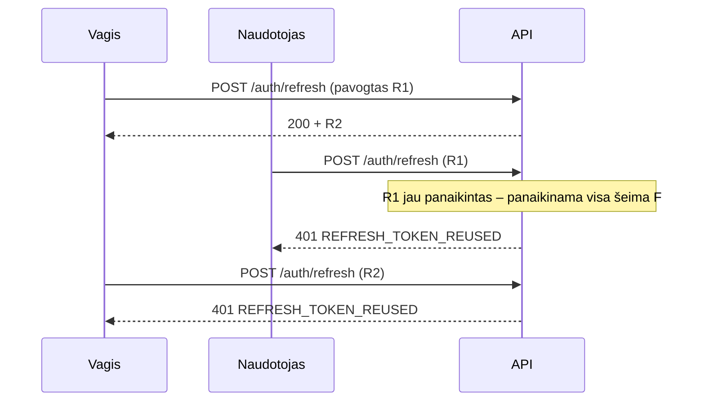

# Hourly – ataskaitos priedai

Papildoma techninė medžiaga prie [projekto ataskaitos](../README.md). Ataskaitoje paliktas tik reikalaujamas turinys, o čia – išsamesni sprendimų aprašai, autentifikacijos schema, klaidų kodai, demonstracija ir laboratorinių darbų reikalavimų atitiktis.

## Turinys

1. [Technologijų pasirinkimas](#1-technologijų-pasirinkimas)
2. [REST principai](#2-rest-principai)
3. [Klaidų apdorojimas](#3-klaidų-apdorojimas)
4. [Autentifikacija ir autorizacija](#4-autentifikacija-ir-autorizacija)
5. [Mašininiai klaidų kodai](#5-mašininiai-klaidų-kodai)
6. [Sąsajos demonstracija ir testai](#6-sąsajos-demonstracija-ir-testai)
7. [Laboratorinių darbų reikalavimų atitiktis](#7-laboratorinių-darbų-reikalavimų-atitiktis)

---

## 1. Technologijų pasirinkimas

**Next.js (React)** – kliento pusės karkasas, pasirinktas dėl komponentinės architektūros ir serverio pusėje generuojamo turinio galimybės. Ji leidžia viešus projektų puslapius pateikti iš karto sugeneruotus, o naudotojo darbo aplinką – kaip vieno puslapio aplikaciją. Naudojama TanStack Query biblioteka užklausų būsenai ir podėliui valdyti bei Tailwind CSS apipavidalinimui.

**Node.js ir Express** – serverio pusės platforma ir karkasas. Pasirinkta dėl tos pačios programavimo kalbos abiejose sistemos dalyse, o tai leidžia dalytis tipų aprašais tarp kliento ir serverio. Express suteikia lankstų tarpinės programinės įrangos (angl. middleware) mechanizmą, patogų autentifikacijos ir autorizacijos tikrinimams įgyvendinti.

**Prisma ORM** – objektinio ir reliacinio atvaizdavimo sąsaja. Aprašo duomenų schemą viename faile, iš kurio generuojami tipizuoti duomenų prieigos metodai ir duomenų bazės migracijos.

**PostgreSQL** – reliacinė duomenų bazių valdymo sistema. Pasirinkta dėl dalinių unikalių indeksų (angl. partial unique index) palaikymo, kuris naudojamas užtikrinti, kad vienam projektui galėtų būti priimtas tik vienas pasiūlymas, o vienas naudotojas tuo pačiu metu galėtų turėti tik vieną neužbaigtą darbo sesiją.

Duomenys iš prigimties reliaciniai: hierarchija projektas → užduotis → sesija su išoriniais raktais ir kaskadiniu šalinimu, pinigai tiksliu `numeric(10,2)` tipu, o pasiūlymo priėmimas keičia tris lenteles vienoje transakcijoje. Svarstytos alternatyvos:

| Alternatyva | Kodėl nepasirinkta |
|---|---|
| MySQL / MariaDB | Tinkama reliacinė DBVS, tačiau neturi dalinių (sąlyginių) unikalių indeksų – taisyklę „viena vykdoma sesija“ tektų įgyvendinti generuojamais stulpeliais arba trigeriais |
| MongoDB | Dokumentinė DB: hierarchiją su ryšiais, kaskadomis ir kelių kolekcijų transakcijomis tektų prižiūrėti programoje; mažiau schemos garantijų pinigų ir laiko apskaitai |
| SQLite | Vienas failas be tinklinio serverio: ribotas lygiagretus rašymas, netinka keliems API egzemplioriams ir Azure App Service be nuolatinio disko; tinka nebent testams |
| Microsoft SQL Server / Azure SQL | Techniškai tinka (yra filtruoti indeksai), tačiau licencijuojama; PostgreSQL atviras, lokaliai veikia Docker konteineryje, o Azure turi valdomą Flexible Server paslaugą |

**JWT (JSON Web Token)** – autentifikacijos ir autorizacijos priemonė. Naudojama trumpos galiojimo trukmės prieigos žetonų (15 min.) ir atnaujinimo žetonų pora. Prieigos žetone yra naudotojo identifikatorius, rolė ir prisijungimo identifikatorius (`sid`), todėl rolė žinoma be papildomos užklausos duomenų bazei, o atsijungus žetonas atmetamas iš karto. Atnaujinimo žetonas saugomas `httpOnly` slapuke, o duomenų bazėje laikoma tik jo maiša. Taikoma žetonų rotacijos strategija: kiekvienas atnaujinimas išduoda naują žetoną ir panaikina ankstesnįjį, o pakartotinai panaudojus jau anuliuotą žetoną panaikinama visa to prisijungimo žetonų šeima. Plačiau – 4 skyriuje.

**Gebėjimo žetonas** (angl. capability token) – antrasis prieigos mechanizmas, skirtas peržiūros nuorodoms. Skirtingai nei JWT, jis nesieja su naudotojo paskyra, o suteikia teisę skaityti vieną konkretų resursą. Žetonas generuojamas kriptografiškai saugiu atsitiktinių skaičių generatoriumi, duomenų bazėje saugoma tik jo maiša, galiojimo laikas ribotas, o teisės apribotos vien skaitymo metodais. Toks sprendimas leidžia dalytis darbo eiga su paskyros neturinčiu užsakovu, neįvedant papildomos registracijos. Kadangi žetonas perduodamas adreso eilutėje, atsakymuose nustatoma `X-Robots-Tag: noindex` antraštė, o nuoroda bet kada gali būti atšaukta nekeičiant paties projekto.

**OpenAPI 3.1** – sąsajos specifikacijos standartas. Specifikacija generuojama iš duomenų validavimo schemų (Zod), todėl dokumentacija nenutolsta nuo realizacijos ([ataskaitos 4 skyrius](../README.md#4-api-specifikacija)).

**Microsoft Azure** – debesų technologijų platforma, pasirinkta dėl universiteto suteikiamo studento kredito. Naudojamos Azure App Service ir Azure Database for PostgreSQL Flexible Server paslaugos ([ataskaitos 2.1 poskyris](../README.md#21-diegimo-diagrama)).

**Git ir GitHub Actions** – versijavimo sistema ir nepertraukiamo integravimo priemonė. Sujungus pakeitimus į pagrindinę šaką automatiškai paleidžiami testai, vykdomos duomenų bazės migracijos ir atnaujinamos Azure paslaugos.

---

## 2. REST principai

| Principas | Kaip įgyvendintas | Ką suteikia |
|---|---|---|
| **Klientas–serveris** | API (`apps/api`) ir internetinė aplikacija (`apps/web`) – atskiri paketai, bendra tik duomenų sutartis `@hourly/shared` | Abi dalys vystomos ir diegiamos nepriklausomai; tą patį API naudoja ir naršyklė, ir Postman |
| **Būsenos neturėjimas** (angl. stateless) | Kiekviena užklausa neša viską, ko reikia: prieigos žetoną `Authorization` antraštėje. Serveris neturi sesijų atmintyje | Bet kuris API egzempliorius gali aptarnauti bet kurią užklausą – galima pridėti egzempliorių |
| **Podėliavimas** (angl. cacheable) | Kiekvienas atsakymas turi `Cache-Control`: `private, no-cache` įprastiems, `no-store` – `/auth/*` ir `/public/*`. Express prideda `ETag`; su `If-None-Match` nepasikeitęs resursas grąžina **304** be kūno ([middleware/cache.ts](../apps/api/src/middleware/cache.ts)) | Mažiau perduodamų duomenų, bet niekada pasenusių; žetonai niekur neišsaugomi |
| **Vienoda sąsaja** | Resursai identifikuojami URI (daiktavardžiai, hierarchija `/projects/{id}/tasks/{id}/sessions`); veiksmai – HTTP metodais; reprezentacijos – JSON arba CSV pagal `Accept` (kitaip 406); pranešimai aprašo save patys (statuso kodai, `Location`, `Allow`, `WWW-Authenticate`, `Retry-After`); **hypermedia** – `_links` su ryšiais ir leidžiamais veiksmais | Klientas nežino serverio vidaus: užtenka HTTP semantikos ir nuorodų, pradedant `GET /api` |
| **Sluoksniuota sistema** | Klientas nežino, ar kalba su API, ar su Next.js tarpiniu maršrutu `/api/[...path]`, ar su Azure balansavimu; visi adresai `_links` santykiniai | Tarpinius sluoksnius (saugumas, podėlis, balansavimas) galima pridėti nekeičiant kliento |
| **Kodas pagal pareikalavimą** (neprivalomas) | Nenaudojamas | – |

**Kur „stateless“ sąmoningai ne visiškas.** Atnaujinimo žetonai saugomi duomenų bazėje, o `authenticate` kiekvienai užklausai patikrina, ar žetono prisijungimas (`sid`) dar galioja. Tai serverio būsena, bet ji yra **duomenų bazėje**, o ne konkretaus proceso atmintyje, todėl horizontalus mastelis išlieka. Kaina – viena paieška pagal indeksą, nauda – tikras atsijungimas ir blokavimas iš karto (4.2 skyrius). Vienintelė proceso atmintyje laikoma būsena – bandymų ribojimo skaitliukai (4.4 skyrius).

**HTTP metodų semantika.** `GET` saugus ir idempotentiškas. `PATCH` keičia tik kūne esančius laukus (dalinis atnaujinimas), todėl `PUT` nenaudojamas ir grąžina 405. `DELETE` idempotentiškas būsenos prasme: nuorodos atšaukimas antrą kartą vėl grąžina 204, o jau ištrintas projektas – 404, bet sistemos būsena nebesikeičia. `POST` naudojamas tik kūrimui (ir autentifikacijos veiksmams).

---

## 3. Klaidų apdorojimas

Visos klaidos grąžinamos vienodu formatu, nepriklausomai nuo to, kuriame sluoksnyje jos kilo – schemos validavime, dalykinėje taisyklėje ar duomenų bazės apribojime:

```json
{
  "error": {
    "code": "INVALID_STATUS_TRANSITION",
    "message": "Cannot change project status from PUBLISHED to IN_PROGRESS.",
    "details": { "from": "PUBLISHED", "to": "IN_PROGRESS" }
  }
}
```

`code` skirtas programai, `message` – žmogui, o neprivalomas `details` nurodo konkretų lauką ar apribojimą. Validavimo klaidų atveju `details` yra laukų medis, todėl kliento pusė gali pažymėti būtent tą įvedimo lauką, kuris neatitiko reikalavimų.

Mašininių klaidų kodų sąrašas – [5 skyriuje](#5-mašininiai-klaidų-kodai).

### Statuso kodų politika

| Kodas | Kada grąžinamas | Pavyzdys |
|---|---|---|
| 200 | Sėkmingas skaitymas arba keitimas | `GET /projects/{id}`, `PATCH /projects/{id}` |
| 201 | Resursas sukurtas; `Location` antraštė rodo jo adresą | `POST /projects/{id}/tasks` |
| 204 | Sėkmė, grąžinti nėra ko | `DELETE …`, `POST /auth/logout` |
| 304 | Resursas nepasikeitė nuo kliento turimos versijos (`If-None-Match`) | pakartotinis `GET` su `ETag` |
| 400 | Užklausos **sintaksė** netinkama – serveris jos net negali suprasti | netaisyklingas JSON, `id` ne UUID, `scope=nesamas` |
| 401 | Naudotojas neatpažintas: žetono nėra, jis netinkamas arba pasibaigęs | užduoties kūrimas be žetono |
| 403 | Naudotojas atpažintas, bet jo rolė ar ryšys su resursu neleidžia veiksmo | specialistas kuria aikštelės projektą, redaguojamas svetimas paskelbtas projektas |
| 404 | Resurso nėra arba naudotojas jo negali matyti | nesamas projektas, svetimas juodraštis, kito projekto užduotis šio projekto adresu |
| 405 | Adresas žinomas, bet metodas nepalaikomas (`Allow` antraštė) | `PUT /projects/{id}` |
| 406 | Prašomas turinio tipas neprieinamas | `Accept: application/xml` ataskaitai |
| 409 | Konfliktas su esama duomenų būsena | antra neužbaigta darbo sesija |
| 413 | Užklausos kūnas didesnis nei 1 MB | per didelis JSON |
| 422 | Užklausa suprantama, bet jos **turinys** prieštarauja taisyklėms | per trumpas pavadinimas, neleistinas būsenos perėjimas, per didelė suma |
| 429 | Viršytas bandymų limitas (`Retry-After`) | 11-as nesėkmingas prisijungimas per 15 min. |
| 500 | Serverio klaida – **neturi pasitaikyti**; priežastis klientui neatskleidžiama | – |
| 503 | Duomenų bazė nepasiekiama | `GET /health/ready` |

Skirtumas tarp 400 ir 422 yra esminis ir nuoseklus visoje sąsajoje: 400 reiškia netvarkingą užklausą, 422 – tvarkingą užklausą su netinkamu turiniu. Tėviniai resursai nurodomi adresu, ne kūne, todėl jų nebuvimas visada yra 404:

- `GET /projects/{ne-uuid}` → **400**, nes toks adresas negali egzistuoti;
- `GET /projects/{nesamas-id}` arba `POST /projects/{nesamas-id}/tasks` → **404**, nes adresas nurodo neegzistuojantį resursą;
- `GET /projects/{A}/tasks/{B projekto užduotis}` → **404**, nes šiuo adresu užduoties nėra;
- `POST /projects/{id}/tasks` su per trumpu pavadinimu → **422**, nes adresas teisingas, o klaida yra turinyje.

---

## 4. Autentifikacija ir autorizacija

Sąsaja naudoja žetonais grįstą autentifikaciją. Prisijungęs naudotojas gauna trumpai galiojantį **prieigos žetoną** (JWT), kurį siunčia su kiekviena užklausa, ir ilgai galiojantį **atnaujinimo žetoną**, kuriuo gauna naują prieigos žetoną, kai ankstesnysis baigia galioti.

### 4.1. Žetonai

|  | Prieigos žetonas | Atnaujinimo žetonas |
|---|---|---|
| Forma | JWT, pasirašytas `HS256` | Atsitiktinė 256 bitų eilutė (ne JWT) |
| Perdavimas | `Authorization: Bearer <žetonas>` | `httpOnly` slapukas `hourly_refresh`, siunčiamas tik `/api/auth` keliu |
| Kliento pusėje | Programos atmintyje | Naršyklės slapukuose, scenarijams nepasiekiamas |
| Serverio pusėje | Nesaugomas – tikrinamas parašas | Duomenų bazėje, tik `sha256` maiša |
| Galiojimas | 15 min. | 30 d. |
| Turinys | `sub` (naudotojo id), `role`, `sid` (prisijungimas), `iat`, `exp`, `iss`, `aud` | – |
| Atšaukimas | Kartu su savo prisijungimu (`sid`) | Atsijungiant, keičiant slaptažodį, blokuojant naudotoją |

Prieigos žetono turinio pavyzdys:

```json
{
  "sub": "a0000000-0000-4000-8000-000000000003",
  "role": "SPECIALIST",
  "sid": "6e894cf1-2c63-43be-a780-18201ac6dc25",
  "iat": 1790276285,
  "exp": 1790277185,
  "iss": "hourly-api",
  "aud": "hourly"
}
```

El. pašto ir kitų asmens duomenų žetone nėra: JWT yra tik užkoduotas, o ne užšifruotas, todėl jo turinį gali perskaityti kiekvienas.

Atnaujinimo žetonas nėra JWT, nes jo turinio niekam nereikia skaityti – serveris jį randa duomenų bazėje pagal maišą. Būtent dėl to jį galima atšaukti. Nutekėjus duomenų bazei, žetonų atkurti iš maišų neįmanoma.

Prieigos žetono tikrinimas ([middleware/auth.ts](../apps/api/src/middleware/auth.ts)):

- **Algoritmas prisegtas.** Priimamas tik `HS256`, todėl žetonai su `alg: none` ar kitu algoritmu atmetami. Taip pat tikrinami `iss`, `aud` ir turinio forma.
- **Rolė imama iš žetono**, tačiau kiekviena užklausa viena paieška patikrina, ar paskyra dar egzistuoja, nėra užblokuota ir ar žetono prisijungimas (`sid`) dar galioja. Todėl užblokuotas arba atsijungęs naudotojas praranda prieigą iš karto, o ne po 15 min.
- **Pasibaigęs žetonas turi atskirą kodą** `TOKEN_EXPIRED`: klientas žino, kad reikia kviesti `/auth/refresh`, o ne rodyti prisijungimo formą.
- **Netinkamas žetonas nereiškia svečio teisių.** Jei žetonas pateiktas, bet netinka, grąžinama 401 net viešame metode – naudotojas tyliai netampa svečiu.
- Kiekvienas 401 atsakymas turi `WWW-Authenticate: Bearer` antraštę (RFC 6750).

### 4.2. Žetonų atnaujinimas ir rotacija



*B.1 pav. Prieigos žetono atnaujinimas*

Kiekvienas atnaujinimo žetonas veikia **vieną kartą**. Jei jau panaudotas žetonas pateikiamas dar kartą, vadinasi, jį turi dvi šalys – savininkas ir tas, kuris jį nukopijavo. Serveris negali nustatyti, kuri iš jų sąžininga, todėl panaikina visą šeimą, t. y. visus to prisijungimo žetonus:



*B.2 pav. Pakartotinio panaudojimo aptikimas*

Teisėtas naudotojas prisijungia iš naujo, o vagis prieigą praranda.

| Įvykis | Kas panaikinama |
|---|---|
| Atsijungimas (`POST /auth/logout`) | To prisijungimo šeima; slapukas išvalomas |
| Slaptažodžio keitimas (`PATCH /auth/me`) | Visos kitos naudotojo šeimos – dabartinis prisijungimas (`sid`) lieka |
| Blokavimas (`PATCH /users/{id}`) | Visos naudotojo šeimos; prieigos žetonai atmetami nuo kitos užklausos |
| Pakartotinis žetono panaudojimas | Ta šeima |

**Prieigos žetonas miršta kartu su savo prisijungimu.** Šeima – tai vienas prisijungimas, o prieigos žetonas ją įvardija `sid` teiginiu. Kiekviena užklausa (toje pačioje paieškoje, kuri tikrina blokavimą) patikrina, ar šeimoje dar yra galiojantis atnaujinimo žetonas. Panaikinus šeimą – atsijungus, pakeitus slaptažodį kitame įrenginyje ar aptikus pakartotinį panaudojimą – tas pats prieigos žetonas nuo kitos užklausos gauna **401 `SESSION_REVOKED`**, o ne veikia iki savo `exp`. Rotacija seną atnaujinimo žetoną panaikina ir naują įrašo vienoje transakcijoje, todėl šeima niekada nelieka be galiojančio žetono ir lygiagrečios užklausos atnaujinimo metu neatmetamos.

JWT lieka pasirašytas ir savarankiškas (rolę ir naudotoją serveris sužino be duomenų bazės), tačiau „stateless“ čia sąmoningai ne visiškas: kaina – viena paieška pagal indeksą kiekvienai užklausai, nauda – tikras atsijungimas.

Metodai `/auth/register`, `/auth/login`, `/auth/refresh` ir `/auth/logout` `Authorization` antraštės nežiūri. Klientai dažnai prideda žetoną prie visų užklausų, todėl kitaip pasibaigęs prieigos žetonas užblokuotų būtent tą užklausą, kuri turi jį pakeisti.

### 4.3. Rolės ir teisės

Sistemoje yra keturios rolės: **svečias** (be žetono), **užsakovas** (`CLIENT`), **specialistas** (`SPECIALIST`) ir **administratorius** (`ADMIN`). Registruojantis galima pasirinkti tik užsakovo arba specialisto rolę.

Teisės tikrinamos dviem žingsniais, o jų atsakymai skiriasi:

1. **Ar naudotojas gali matyti resursą?** Jei ne – **404**, lygiai toks pat, kaip neegzistuojančiam resursui. Taip svetimo juodraščio identifikatorius neatskleidžia, kad projektas egzistuoja.
2. **Ar gali atlikti šį veiksmą?** Jei mato, bet negali – **403**.

Paskelbtą projektą mato visi, kitus – tik jo šalys ir administratorius. Administratorius mato viską (moderavimui ir ginčams spręsti), gali šalinti projektus ir naudotojus, tačiau svetimų projektų, užduočių ir sesijų nekeičia.

Visos taisyklės surašytos viename faile – [services/access.ts](../apps/api/src/services/access.ts), – o kiekviena lentelės eilutė turi testą ([access.test.ts](../apps/api/src/services/access.test.ts)).

Žymėjimai: **S** – svečias, **U** – užsakovas, **Sp** – specialistas, **A** – administratorius; „šalis“ – projekto užsakovas arba jį vykdantis specialistas.

| Metodai | S | U | Sp | A |
|---|---|---|---|---|
| `POST /auth/register`, `/login`, `/refresh`, `/logout` | ✓ | ✓ | ✓ | ✓ |
| `GET`, `PATCH /auth/me`; `GET /users/{id}` | 401 | ✓ | ✓ | ✓ |
| `GET /users`; `PATCH`, `DELETE /users/{id}` | 401 | 403 | 403 | ✓, išskyrus save |
| `GET /projects?scope=marketplace` | ✓ | ✓ | ✓ | ✓ |
| `GET /projects?scope=owned` arba `assigned` | 401 | ✓ | ✓ | ✓ |
| `GET /projects?scope=all` | 401 | 403 | 403 | ✓ |
| `GET /projects/{id}`, `/projects/{id}/tasks`, `/projects/{id}/tasks/{taskId}` | paskelbtas | šalis arba paskelbtas | šalis arba paskelbtas | ✓ |
| `POST /projects` – aikštelės projektas | 401 | ✓ | 403 | 403 |
| `POST /projects` – tiesioginis projektas | 401 | 403 | ✓ | 403 |
| `PATCH /projects/{id}`; užduočių kūrimas, keitimas, šalinimas; peržiūros nuorodos | 401 | šalis | šalis | 403 |
| `DELETE /projects/{id}` | 401 | savo aikštelės projektas | savo tiesioginis projektas | ✓ |
| `GET /projects/{id}/report`, `…/tasks/{taskId}/sessions`, `…/sessions/{sessionId}` | 401 | šalis | šalis | ✓ |
| `GET /tasks`, `/sessions`, `/proposals` | 401 | savo | savo | savo |
| `POST …/tasks/{taskId}/sessions`; `PATCH`, `DELETE …/sessions/{sessionId}` | 401 | 403 | vykdytojas, sesijos autorius | 403 |
| `GET /projects/{id}/proposals`, `…/proposals/{proposalId}` | 401 | visi savo projekto | tik savo | visi |
| `POST /projects/{id}/proposals` | 401 | 403 | ✓ | 403 |
| `PATCH /projects/{id}/proposals/{proposalId}` | 401 | priimti, atmesti | atšaukti savo | 403 |
| `DELETE /projects/{id}/proposals/{proposalId}` | 401 | 403 | savo | 403 |
| `GET /public/projects/{token}`, `GET /health` | ✓ | ✓ | ✓ | ✓ |

Kai naudotojas nėra projekto šalis, atsakymas yra 404, jei projektas jam nematomas, ir 403, jei matomas (paskelbtas).

Administratorius negali užblokuoti ar ištrinti savo paskyros (422). Naudotojo, kuris dalyvauja projektuose arba turi darbo sesijų, ištrinti negalima (409) – kaskadinis šalinimas ištrintų ir kitos šalies įrašus, todėl tokį naudotoją reikia blokuoti.

### 4.4. Saugumo priemonės

| Grėsmė | Priemonė |
|---|---|
| Slaptažodžių nutekėjimas iš duomenų bazės | `bcrypt`, kaina 12 |
| Atnaujinimo žetonų nutekėjimas iš duomenų bazės | Saugoma tik `sha256` maiša |
| XSS pavagia atnaujinimo žetoną | `httpOnly` slapukas |
| CSRF per slapuką | `SameSite=Lax`, `Path=/api/auth`, CORS tik iš `WEB_ORIGIN` |
| Pavogtas atnaujinimo žetonas | Rotacija ir visos šeimos panaikinimas pakartotinai jį panaudojus |
| Pavogtas prieigos žetonas | Galioja tik 15 min.; atsijungus nustoja galioti iš karto (`sid`) |
| Slaptažodžio spėliojimas (brute force) | Po 10 nesėkmingų bandymų tam pačiam el. paštui iš to paties adreso per 15 min. – **429** su `Retry-After`; registracija – 30 per valandą, `/auth/refresh` – 30 nesėkmių per 15 min. ([lib/rate-limit.ts](../apps/api/src/lib/rate-limit.ts)) |
| Suklastotas žetonas, `alg: none` | Parašo patikra, leidžiamas tik `HS256` |
| Teisių didinimas registruojantis | Registracijoje leidžiamos tik `CLIENT` ir `SPECIALIST` rolės |
| Naudotojų išvardijimas | Vienodas 401 nežinomam el. paštui ir blogam slaptažodžiui, vienodas atsakymo laikas; svetimi resursai – 404 |
| Užblokuotas naudotojas su galiojančiu žetonu | Paskyros būsena tikrinama kiekvienoje užklausoje |
| Prieiga prie svetimų resursų (IDOR) | Matomumo ir teisių patikros kiekviename metode, padengtos testais |
| Silpna paslaptis gamybinėje aplinkoje | Paleidžiant tikrinama, ar `JWT_ACCESS_SECRET` turi bent 32 simbolius |

---

## 5. Mašininiai klaidų kodai

| Kodas | Reikšmė |
|---|---|
| `MALFORMED_JSON` | Užklausos kūnas nėra taisyklingas JSON |
| `INVALID_PATH_PARAM`, `INVALID_QUERY` | Netinkamas adreso arba užklausos parametras |
| `VALIDATION_ERROR` | Turinys neatitinka duomenų schemos |
| `AUTH_REQUIRED` | Metodui reikia prisijungti, o žetono nėra |
| `INVALID_TOKEN`, `TOKEN_EXPIRED` | Prieigos žetonas netinkamas arba pasibaigęs |
| `SESSION_REVOKED` | Žetono prisijungimas baigtas (atsijungta, pakeistas slaptažodis, aptiktas pakartotinis panaudojimas) |
| `TOO_MANY_REQUESTS` | Viršytas bandymų limitas; `Retry-After` nurodo, po kiek sekundžių bandyti vėl |
| `INVALID_CREDENTIALS` | Neteisingas el. paštas arba slaptažodis |
| `INVALID_REFRESH_TOKEN`, `REFRESH_TOKEN_REUSED` | Atnaujinimo žetono nėra, jis nežinomas, pasibaigęs arba jau panaudotas |
| `FORBIDDEN` | Rolė arba ryšys su resursu neleidžia veiksmo |
| `ACCOUNT_BLOCKED` | Naudotojas užblokuotas |
| `EMAIL_TAKEN` | Paskyra su tokiu el. paštu jau yra |
| `INVALID_PASSWORD` | Keičiant slaptažodį neteisingai nurodytas dabartinis |
| `CANNOT_MODIFY_SELF`, `USER_HAS_WORK_HISTORY` | Administratorius bando blokuoti save arba šalinti naudotoją su darbo istorija |
| `NOT_FOUND` | Resursas nerastas (taip pat – vaikas ne savo tėvo adresu) |
| `METHOD_NOT_ALLOWED` | Adresas žinomas, metodas – ne |
| `MALFORMED_URL`, `BAD_REQUEST` | Adreso nepavyksta iškoduoti arba kita užklausos klaida, aptikta Express |
| `VALUE_OUT_OF_RANGE` | Skaičius netelpa į duomenų bazės stulpelį |
| `INVALID_REFERENCE` | Nurodytas neegzistuojantis susijęs įrašas |
| `INVALID_STATUS_TRANSITION` | Neleistinas projekto būsenos perėjimas |
| `INVALID_BUDGET_RANGE`, `INVALID_TIME_RANGE`, `TIMESTAMP_IN_FUTURE` | Nenuoseklios reikšmės |
| `PROJECT_CLOSED`, `PROJECT_NOT_IN_PROGRESS`, `PROJECT_NOT_PUBLISHED` | Veiksmas neatitinka projekto būsenos |
| `NO_PROPOSAL_STAGE`, `PROPOSAL_NOT_PENDING`, `PROPOSAL_ACCEPTED` | Pasiūlymų gyvavimo ciklo taisyklės |
| `SESSION_ALREADY_RUNNING`, `PROPOSAL_ALREADY_SUBMITTED`, `CONFLICT` | Konfliktai su esama būsena |
| `NOT_ACCEPTABLE` | Neprieinamas prašomas turinio tipas |
| `INTERNAL_ERROR` | Vidinė serverio klaida (gamyboje priežastis neatskleidžiama) |

Dalis konfliktų tikrinama dviem lygmenimis: programa pateikia aiškų pranešimą, o galutinę garantiją duoda duomenų bazės daliniai unikalūs indeksai (`work_sessions_one_open_per_specialist`, `proposals_one_accepted_per_project`). Tik pastarieji apsaugo tuo atveju, kai dvi užklausos ateina vienu metu.

---

## 6. Sąsajos demonstracija ir testai

Sąsajos veikimą galima patikrinti trimis būdais.

**1. Swagger UI** – adresu `http://localhost:4000/api/docs`. Specifikacija generuojama iš tų pačių Zod schemų, kuriomis validuojamos užklausos, todėl dokumentacija negali nutolti nuo realizacijos. Ta pati specifikacija saugoma ir saugykloje ([ataskaitos 4.1 poskyris](../README.md#41-specifikacija-ir-pavyzdžiai)); nepertraukiamo integravimo darbo eiga tikrina, ar įrašyti failai atitinka kodą.

**2. Automatinė demonstracija** – Postman kolekcija, paleidžiama per Newman. Kolekcija prisijungia demonstracinėmis paskyromis, todėl prieš pirmą paleidimą reikia `npm run db:seed`:

```bash
npm run dev:api   # viename terminale
npm run demo      # kitame
```

Kolekciją taip pat galima importuoti į Postman ([kolekcija](postman/hourly.postman_collection.json), [aplinka](postman/hourly.local.postman_environment.json)) ir paleisti mygtuku „Run collection“.

Kolekciją sudaro septynios dalys:

| Dalis | Turinys |
|---|---|
| 0. Autentifikacija | Registracija, žetono rotacija, pakartotinio panaudojimo aptikimas, atsijungimas (prieigos žetonas atmetamas iš karto – `SESSION_REVOKED`), savo paskyros redagavimas (rolė iš kūno ignoruojama), 409 / 422 / 401 / 403 atvejai, JWT turinio patikra ir prisijungimas keturiomis paskyromis |
| 1. Darbo eiga | Pilnas gyvavimo ciklas: visi 15 pagrindinių metodų, hierarchiniai metodai, du konkuruojantys pasiūlymai (priėmus vieną, kitas atmetamas), ataskaita (JSON ir CSV), peržiūros nuoroda; puslapiavimas ir filtrai; hypermedia – užklausos, sekančios `_links` |
| 2. Klaidų apdorojimas | Kodai 400, 401, 404, 405, 406 ir 422 su skirtingomis priežastimis, tarp jų – suklastotas žetonas, vaikas ne savo tėvo adresu ir ribiniai atvejai, kurie anksčiau grąžindavo 500 (NUL simbolis, neiškoduojamas adresas, per didelė suma) |
| 3. Rolės ir teisės | 4.3 skyriaus lentelė: kas mato, kas gali kurti, redaguoti ir šalinti; 403 ir 404 skirtumas |
| 4. Administratorius | Naudotojų sąrašas, viešas profilis, blokavimas (žetonas atmetamas iš karto), atblokavimas, šalinimas, netinkamo projekto pašalinimas |
| 5. Valymas | Sukurtų duomenų šalinimas ir 204 bei 404 atsakymų patikra |
| 6. Bandymų ribojimas | Dešimt nesėkmingų prisijungimų (401), vienuoliktas – 429 su `Retry-After`. El. paštas kiekvienam paleidimui naujas, todėl ankstesni paleidimai neišnaudoja limito |

Scenarijus sukuria viską, ko jam reikia, ir pabaigoje ištrina – taip pat ir demonstracijos metu užregistruotą paskyrą, – todėl demonstraciją galima kartoti nepaleidžiant pradinių duomenų iš naujo. Rezultatas:

```
requests 140 | assertions 300 | failed 0 | total run duration: ~18s
```

Kolekcija kviečia **visus** dokumentuotus metodus. Tai tikrina CI: `npm run postman:coverage` palygina `docs/openapi.json` operacijas su kolekcijos užklausomis ir nepavyksta, jei kuriam nors metodui užklausos nėra.

Kadangi laikai užklausose fiksuoti, testai tikrina ne „kažkokį skaičių“, o konkrečias reikšmes: serverio apskaičiuotą 90 minučių trukmę, iš projekto paveldėtą 40 EUR/val. įkainį bei 210 minučių ir 140 EUR suvestinę – tą pačią tiek ataskaitoje, tiek viešoje peržiūroje.

**3. Vienetiniai testai** – `npm run test` paleidžia 299 testus, tikrinančius dalykines taisykles (būsenų perėjimus, įkainio paveldėjimą, trukmės skaičiavimą, klaidų kodų politiką), žetonų pasirašymą ir tikrinimą (tarp jų – suklastotus ir pasibaigusius žetonus), atnaujinimo žetonų rotaciją, visą rolių ir teisių lentelę ir tai, kad atsakymų struktūra atitinka OpenAPI specifikaciją.

---

## 7. Laboratorinių darbų reikalavimų atitiktis

Lentelėse – oficialūs vertinimo kriterijai (skliaustuose – balai), kaip jie tenkinami ir kur tai parodyti. Stulpelyje „Demonstracija“ nurodytos Postman kolekcijos dalys (6 skyrius).

### 7.1. 1 laboratorinis darbas – REST sąsaja

| Kriterijus | Kaip tenkinamas | Demonstracija |
|---|---|---|
| **Bent 3 taikomosios srities objektai ir operacijos su jais (3)** | | |
| ↳ prasmingi objektai, ne naudotojai | Projektas (15 laukų), užduotis (11), darbo sesija (10) – [ataskaitos 4.2 poskyris](../README.md#42-taikomosios-srities-objektai) | [schema.prisma](../apps/api/prisma/schema.prisma) |
| ↳ CRUD ir LIST kiekvienam | 15 pagrindinių metodų – [ataskaitos 4.3 poskyris](../README.md#43-sąsajos-metodai) | „1. Darbo eiga“ |
| ↳ puslapiavimas | Visi 9 sąrašai: `page`, `perPage`, vokas su `total` ir `totalPages` | „1. / Puslapiavimas ir filtrai“ |
| ↳ filtravimas | Būsena, paieška, laikotarpis, `running`, `active` ir kt. – [ataskaitos 4.3 poskyrio](../README.md#43-sąsajos-metodai) lentelė | „1. / Puslapiavimas ir filtrai“ |
| ↳ hypermedia | `_links` kiekviename resurse: ryšiai ir pagal rolę bei būseną leidžiami veiksmai; sąrašų `first/prev/next/last`; įėjimo taškas `GET /api` | „1. / Hypermedia“ |
| ↳ resursas iš kelių esybių | `GET /projects/{id}/report` – projektas, jo užduotys ir sesijos su suvestine (JSON arba CSV); `GET /public/projects/{token}` – tas pats be paskyros | „1. / ataskaita JSON, CSV“ |
| **Objektų hierarchinis sąryšis (1)** | Projektas ──< Užduotis ──< Darbo sesija: du vienas-su-daug ryšiai, išoriniai raktai su kaskadomis; naudotojų lentelė į grandinę neįeina | [ataskaitos 4.2 poskyris](../README.md#42-taikomosios-srities-objektai) |
| **Paruošta testavimo aplinka (1)** | Postman kolekcija ir aplinka (140 užklausų, 300 patikrų), paleidžiama `npm run demo`; CI tikrina, kad kolekcija kviečia **visus 41** dokumentuotus metodus (`npm run postman:coverage`); Swagger UI `/api/docs` | 6 skyrius |
| **Duomenų bazė užpildyta prasmingais duomenimis (1)** | Kiekvienoje su hierarchija susijusioje lentelėje ≥ 5 įrašai: 11 projektų, 38 užduotys, 41 sesija, 11 pasiūlymų, 7 peržiūros nuorodos (ir 13 naudotojų); realistiški lietuviški duomenys, visos būsenos | [seed.ts](../apps/api/prisma/seed.ts), [ataskaitos A priedas](../README.md#a-projekto-paleidimas) |
| **Grąžinami teisingi kodai (2)** | 200, 201 + `Location`, 204, 304, 400, 401, 403, 404, 405 + `Allow`, 406, 409, 413, 422, 429, 503 – 3 skyrius. 500 negrąžinamas: ribiniai atvejai (NUL simbolis, neiškoduojamas adresas, per didelis skaičius, `null` kūnas) patikrinti ir padengti testais | „2. Klaidų apdorojimas“, „2. / Ribiniai atvejai (niekada 500)“ |
| **REST semantikos laikymasis ir apimtis (2)** | Daiktavardžiai URI, veiksmai – HTTP metodais (2 skyrius). Trijų lygių metodai `/projects/{id}/tasks/{id}/sessions[/{id}]`; kiekvienas vaikas ieškomas savo tėvo viduje, kitaip 404 ([lib/scope.ts](../apps/api/src/lib/scope.ts)) | „1. / 3 lygių hierarchija“, „2. / Apimtis per URL ir metodai“ |

### 7.2. 2 laboratorinis darbas – autentifikacija ir autorizacija

| Kriterijus | Kaip tenkinamas | Demonstracija |
|---|---|---|
| **Integruota autorizacija naudojant JWT (3)** | Prieigos žetonas – JWT, pasirašytas `HS256` ([lib/tokens.ts](../apps/api/src/lib/tokens.ts)); jame `sub` (naudotojo ID), `role` ir `sid`. Apsaugoti metodai be žetono grąžina 401 su `WWW-Authenticate` | „0. / JWT turinio patikra“, „2. / 401“ |
| **Tinkama žetonų atnaujinimo strategija (2)** | Prieigos žetonas galioja 15 min., atnaujinimo – 30 d. (`httpOnly` slapukas). Rotacija: kiekvienas atnaujinimo žetonas veikia vieną kartą; pakartotinai panaudojus panaikinama visa šeima. Naudotojui nereikia prisijungti iš naujo | 4.2 skyrius; „0. / rotacija, pakartotinis panaudojimas“ |
| **Realizuoti register, login ir logout (2)** | Vietinė autentifikacija. Žetonai valdomi serveryje (DB saugomos maišos). Atsijungimas panaikina prisijungimo šeimą, o to prisijungimo prieigos žetonai atmetami iš karto (`SESSION_REVOKED`). Dviejų faktorių autentifikacija nerealizuota | „0. Autentifikacija“ |
| **Autorizacija pagal rolę ir ID, bent 3 rolės (3)** | `CLIENT`, `SPECIALIST`, `ADMIN` (ir svečias). Rolės – `requireRole` (pvz., `/users` tik administratoriui). Nuosavybė – [services/access.ts](../apps/api/src/services/access.ts) ir `services/*`: svetimos sesijos neredaguosi, svetimo pasiūlymo nepriimsi ir neištrinsi, svetimas juodraštis tau neegzistuoja (404). Visa matrica – 4.3 skyriuje | „3. Rolės ir teisės“, „4. Administratorius“ |

### 7.3. Papildomai

Šie dalykai vertinimo kriterijuose nenurodyti, bet realizuoti:

| Dalykas | Kaip |
|---|---|
| OpenAPI specifikacija | Generuojama iš tų pačių Zod schemų, kurios tikrina užklausas; [api-spec.yaml](../api-spec.yaml), [docs/api.md](api.md) su užfiksuotais pavyzdžiais, `/api/docs`; CI tikrina, ar sutampa su kodu |
| Bandymų ribojimas | 429 su `Retry-After` prisijungimui, registracijai ir atnaujinimui (4.4 skyrius; „6. Bandymų ribojimas“) |
| Saugus slaptažodžių ir žetonų saugojimas | `bcrypt`; atnaujinimo ir peržiūros žetonų tik `sha256` maišos |
| Podėliavimas | `Cache-Control`, `ETag` → 304 („1. / Podėlis“) |
| Automatiniai testai ir CI | 299 vienetiniai ir integraciniai testai; GitHub Actions: lint, testai, OpenAPI, Postman aprėptis, demonstracija su tikra DB |
| Demonstracija | `npm run demo` – 140 užklausų per ~18 s |
| Kodas ir dokumentacija | GitHub; ataskaita – [README.md](../README.md), darbų planai – [docs/planas.md](planas.md), [docs/planas-2.md](planas-2.md), [docs/planas-pataisos.md](planas-pataisos.md), [docs/planas-3.md](planas-3.md) |
